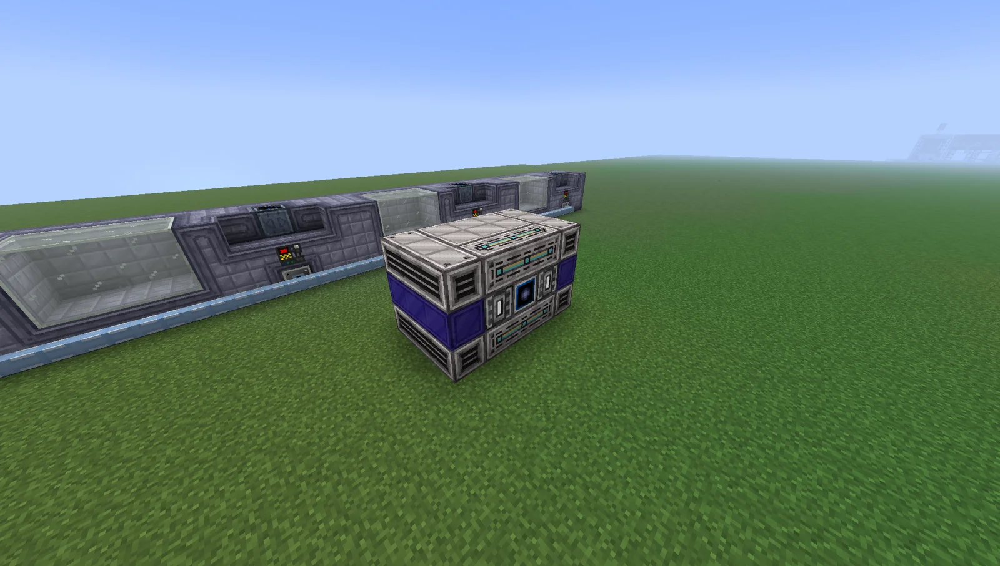
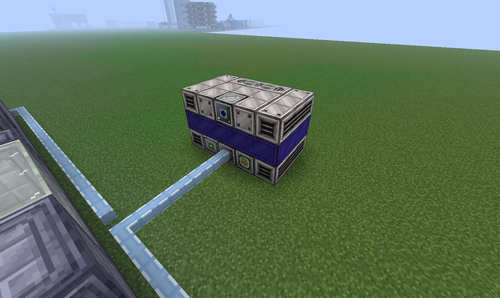
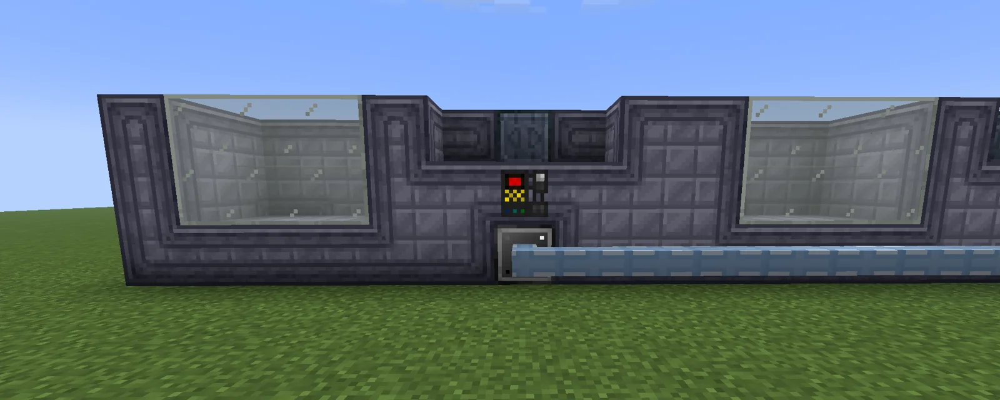

# Pattern Distribution Machine (PDM)
<small>**Submitted by:** satire (@interceptor._) · Multiblock Design Contest, September 2026</small>

!!! quote ""

| | |
|---|---|
| **Target tier** | somewhere <LuV>LuV</LuV> or <ZPM>ZPM</ZPM> or <UV>UV</UV> |
| **Role** | Logistics/storage — AE2 pattern holder that spreads crafts evenly over connected machines |
| **Schematic** | Not provided (block list posted inline, see Structure) |
| **Original post** | [Pattern Distribution Machine](https://discord.com/channels/1177211394039484477/1553343304056307732) |

## Summary

A multiblock that stores AE2 patterns in its own inventory and, when a pattern is requested, distributes the craft equally across every machine of the same type wired to it. The author describes it as "a better ME Pattern Buffer and its proxy, but as a multiblock" and, later in the thread, as an optional quality-of-life structure for players who already have normal AE2 automation running.

## Mechanics

- Patterns are stored inside the multiblock. In the screenshots this is done with Advanced Data Access Hatches on the front, but the author notes a different, dedicated block would be needed.
- The PDM is connected to the main AE2 network through a Data Reception Hatch on top (ingredients come in over ME cable).
- On the back, a Data Transmission Hatch links the PDM to machines of one type (for example Assemblers) through a new special kind of cable, or possibly an AE2 cable. The multiblock pushes ingredients to the machines over that cable and receives the products back over it.
- When a pattern is requested, the PDM counts the connected machines and their parallel hatches, then sends the resources, together with the required Program Card, according to that calculation. The author suggests it could also display craft status, such as remaining time and power consumed.
- To avoid rechecking the whole network on every request, the author proposes a "Recalculate Machines" button in the multiblock GUI: pressing it re-counts the connected machines and their parallel hatches so the next distribution uses the new layout. This is meant to make scaling easier (connect one wire and the machine is ready).
- Power draw scales linearly with the number of stored patterns, proposed at about 256 EU/t per pattern, drawn only while that pattern is being requested.
- Proposed v2 / extension: a version that behaves like a universal pattern system, exposing non-consumed items (lenses, extruder molds, and so on) to the connected machines, or a special hatch that lets each recipe set the machine mode and the needed lens or mold. The author presents this as a follow-up idea, not part of the entry.

## Structure

A small compact block of Fluix Steel Casings, Computer Casings and Advanced Computer Casings topped with Computer Heat Vents; the structure definition the author pasted in the thread spans 3 wide, 3 tall and 5 long, with a High Performance Computation Array as the controller. The posted block list requires: 12 Computer Heat Vents, 9 Fluix Steel Casings (`kubejs:fluix_steel_casing`), 8 Computer Casings, 6 Advanced Computer Casings, 2 Advanced Data Access Hatches, 1 Data Transmitter Hatch, 1 Data Receiver Hatch, 1 LuV Energy Input Hatch, 1 Auto Maintenance Hatch and 1 High Performance Computation Array.

!!! abstract "Screenshots"

    === "Front"
        

    === "Back with cable"
        

    === "Connected machine"
        

## Notes from the thread

- Asked whether this is just an ME Pattern Buffer plus proxies with wires, the author (and others) pointed out that the difference is the equal distribution of recipes across all connected machines.
- Niriun felt the design removes automation challenges without adding much to the pack, and noted that a machine cover for changing machine modes already exists. The author answered that it is gated to UV for that reason, like the Chemical Plants, so normal AE2 automation has to be done first, and agreed it is an optional QoL multiblock that does not majorly change anything.
- Spiffy floated a related idea (a pattern buffer that synthesizes material patterns automatically, connected to extruders and benders over optical cable); both agreed it would be hard to implement and it was not added to this entry.
