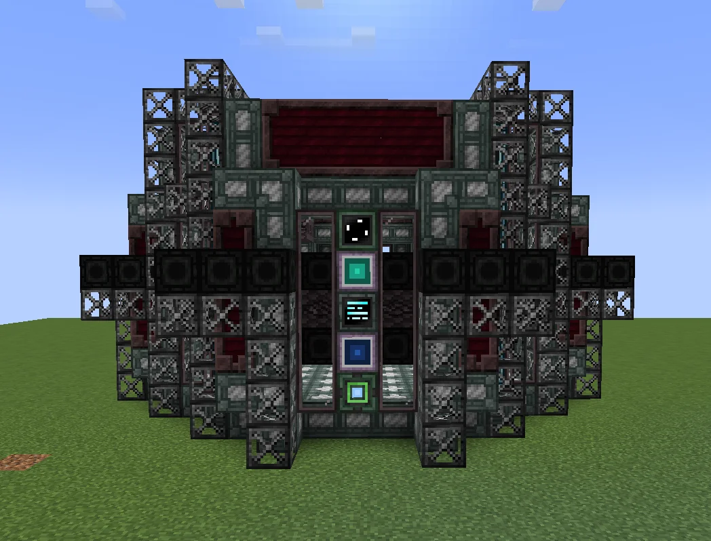
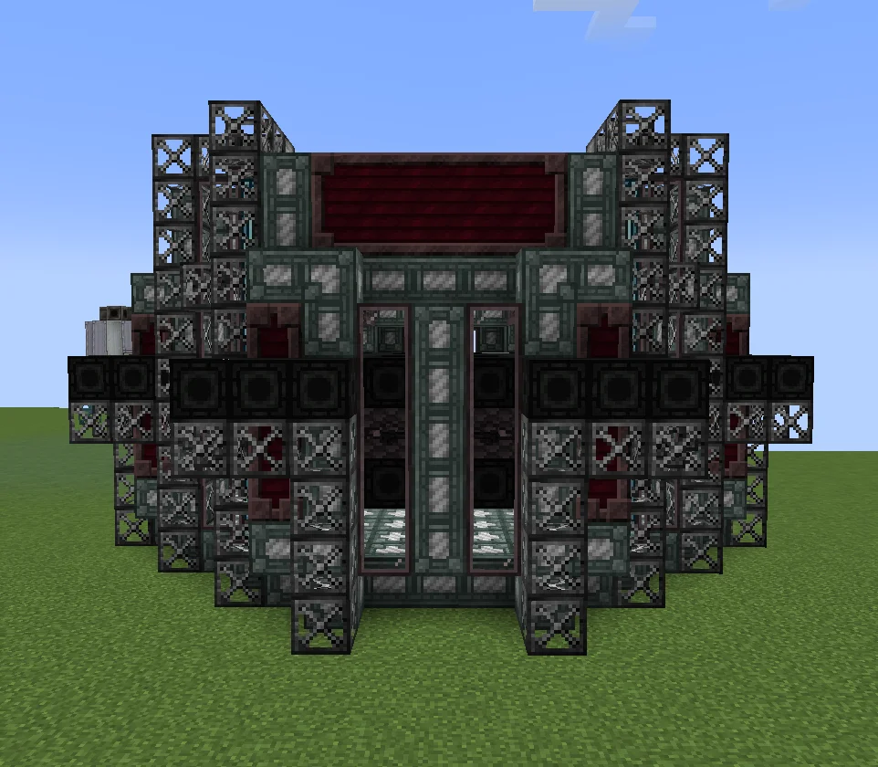
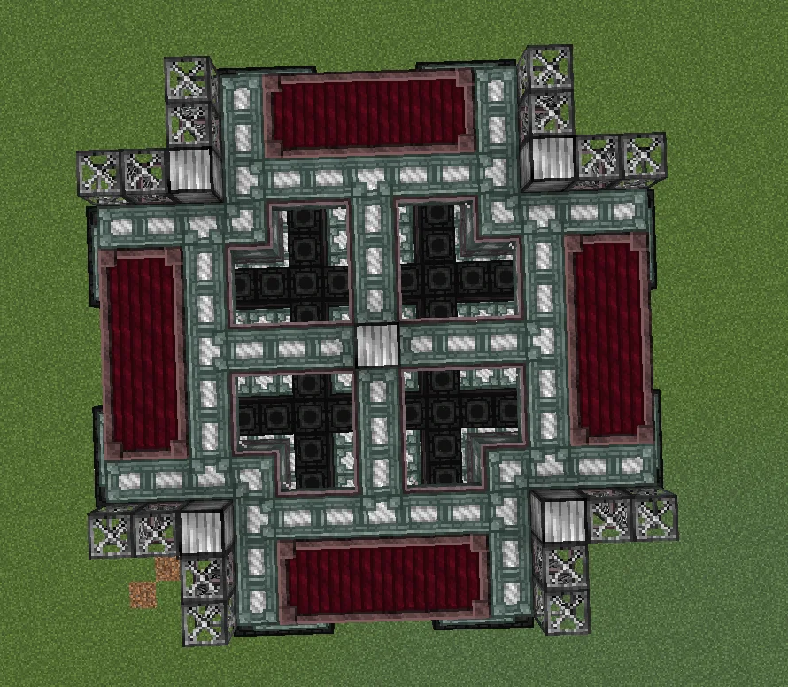
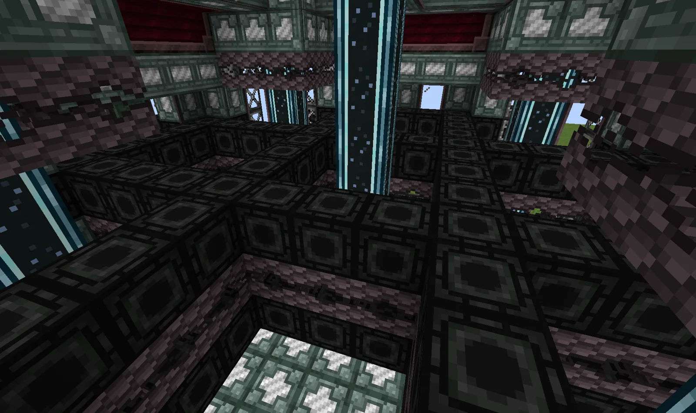

# Plasma Factory (PF)
<small>**Submitted by:** Slime_1001 (@slime_1001_35437) · Multiblock Design Contest, September 2026</small>

!!! quote ""

| | |
|---|---|
| **Target tier** | <UV>UV</UV> |
| **Role** | Processing — plasma production for Plasma Turbines |
| **Schematic** | [pf.json](Contest_img/plasma-factory/pf.json) |
| **Original post** | [Plasma Factory [PF]](https://discord.com/channels/1177211394039484477/1553036189559300237) |

## Summary

A <UV>UV</UV> multiblock dedicated to making plasma. It only produces the plasmas that can be consumed by Plasma Turbines, and it supports reflector overclocking, subtick processing, a Parallel Hatch, and a Laser Hatch. Feeding it certain fluids grants output, input, or speed bonuses.

## Mechanics

- Only runs plasma recipes whose output can be burned in Plasma Turbines.
- Supports reflector overclock, subtick, Parallel Hatch, and Laser Hatch.
- **Helium bonus:** supplying 1000 B of Helium gas per hour gives +25% plasma output.
- With Helium supplied, one of the following additional bonuses can be active (only one at a time):
    - 3200 B of liquid Iron per hour reduces the input materials by 18 mB.
    - 2400 B of liquid Nickel per hour adds 18 mB to the plasma output.
    - 18360 B of Argon gas per hour multiplies the recipe duration by 0.8.

## Structure

A large, four-way symmetrical block with dark red casing panels on each face, open frame "wings" at the corners, and a central column running through the interior; the author did not state the dimensions. The schematic's block list is built from Fusion Casing MK3, Enriched Naquadah Pipe Casing, Neutronium Frames and Blocks, Reinforced Fusion Glass, Tritanic Blasting Casing, Reinforced Reflector Casing, and Stellarium Casing, with a UV Parallel Hatch, a UV 256A Laser Target Hatch, and ME Input/Output Hatches.

!!! abstract "Screenshots"

    === "Front"
        

    === "Back"
        

    === "Top view"
        

    === "Interior"
        

## Files

- [pf.json](Contest_img/plasma-factory/pf.json) — JSON schematic (Building Gadgets-style template with block-state map and required-item list)

## Notes from the thread

- One commenter suggested the structure should be <UEV>UEV</UEV> rather than <UV>UV</UV>; the author did not respond.
