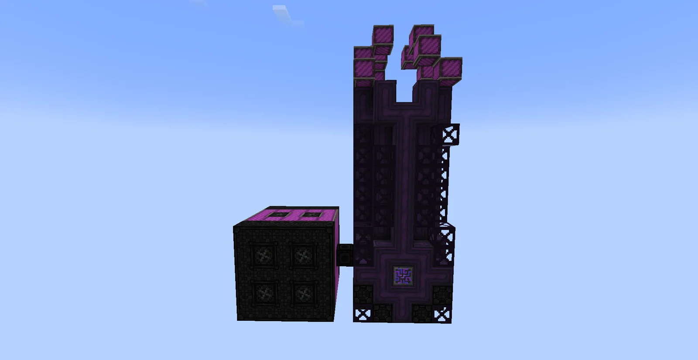
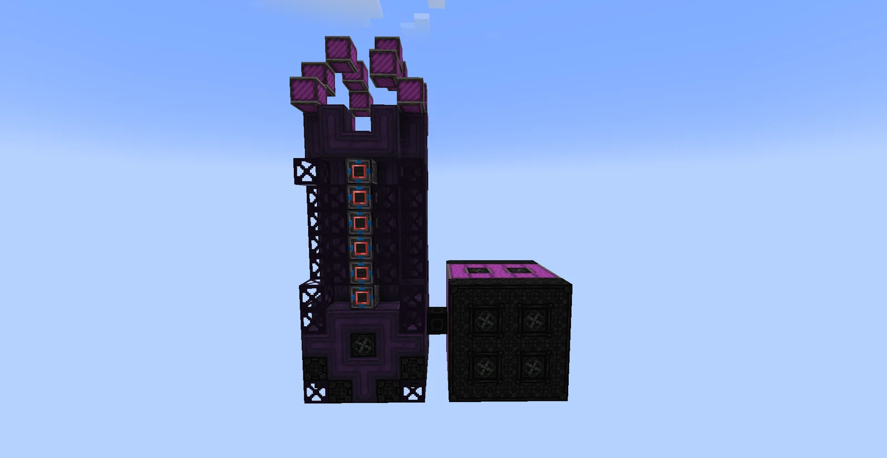
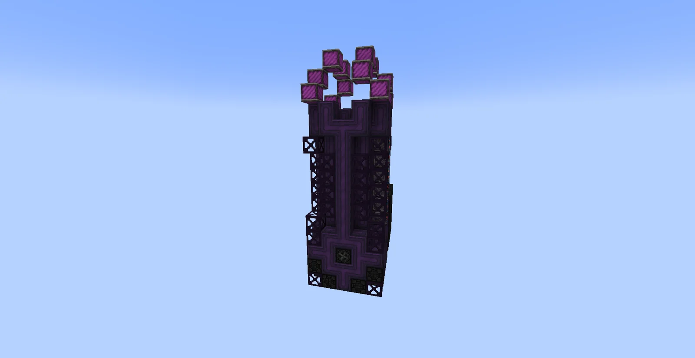
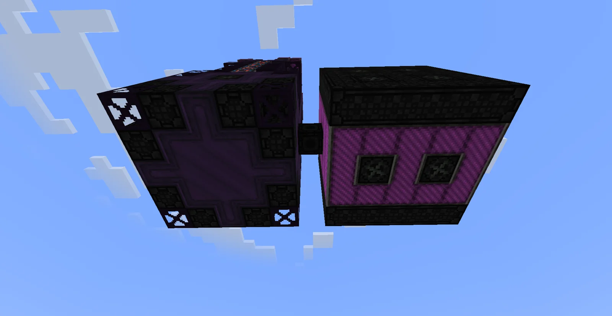
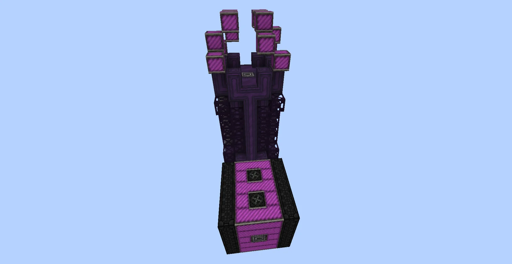
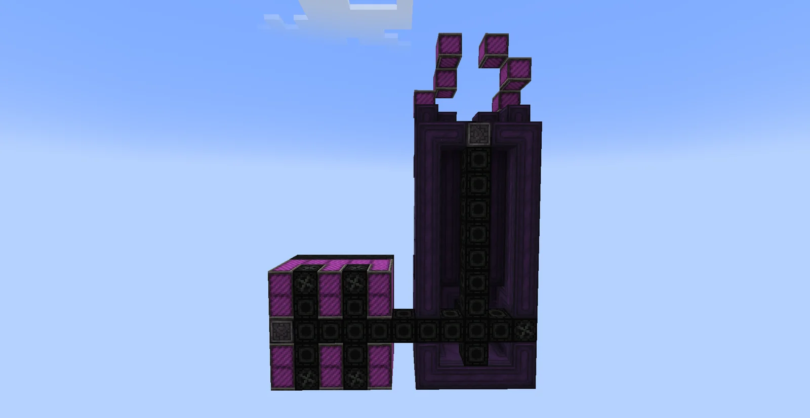
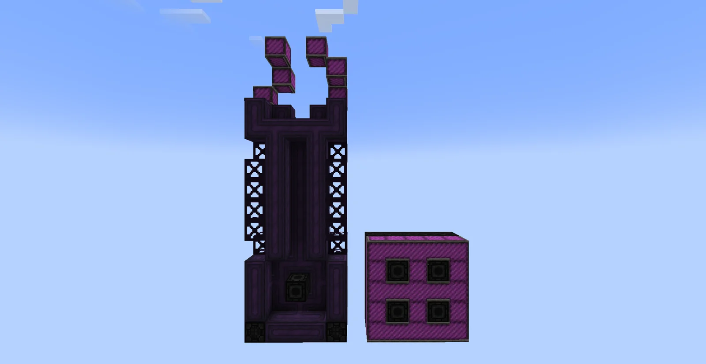

# Pyrolytic Compound Breakdown Unit
<small>**Submitted by:** デイモス (@71i6) · Multiblock Design Contest, September 2026</small>

!!! quote ""

| | |
|---|---|
| **Target tier** | <UV>UV</UV> |
| **Role** | Processing — Pyrolyse Oven with built-in distillation |
| **Schematic** | [pyrolytic-compound-breakdown-unit.txt](Contest_img/pyrolytic-compound-breakdown-unit/pyrolytic-compound-breakdown-unit.txt) |
| **Original post** | [Pyrolytic Compound Breakdown Unit](https://discord.com/channels/1177211394039484477/1555186766766546985) |

## Summary

A <UV>UV</UV> Pyrolyse Oven that distills the fluids and gases it outputs inside the same structure, so the pyrolysis products come out already separated instead of needing a separate Distillation Tower.

## Mechanics

- Runs Pyrolyse Oven recipes and distills the resulting fluids/gases in-structure.
- Keeps the Pyrolyse Oven overclock.
- Supports a Parallel Hatch, subtick processing, and Batch Mode.
- The author suggests the machine could make Nitrobenzene a more attractive option for players who like using it, and speculates that a better gas turbine may be added at some point.

## Structure

Two connected parts: a tall, narrow distillation tower in Enriched Naquadah casings and Trinaquadalloy frames, with Zalloy coils inside and a crown of Enriched Naquadah intake casings on top, joined by a short Enriched Naquadah pipe-casing bridge to a cube-shaped oven section whose faces carry the hatches. The schematic occupies a 5 × 15 × 11 bounding box (341 blocks). The author did not state the dimensions in the post.

!!! abstract "Screenshots"

    === "Front"
        

    === "Back"
        

    === "Side"
        

    === "Top view"
        

    === "Oven end"
        

    === "Interior cross-section"
        

    === "Interior, other side"
        

## Files

- [pyrolytic-compound-breakdown-unit.txt](Contest_img/pyrolytic-compound-breakdown-unit/pyrolytic-compound-breakdown-unit.txt) — structure export as a block-state array with a required-items list (not a Litematica file)
