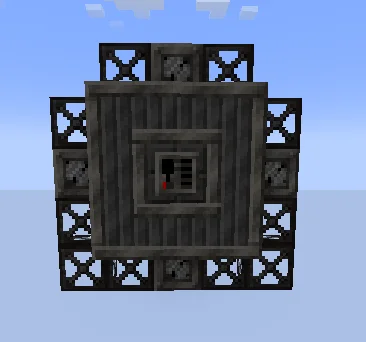
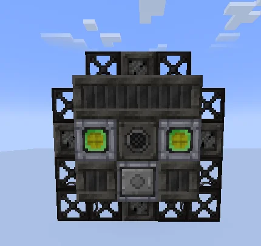
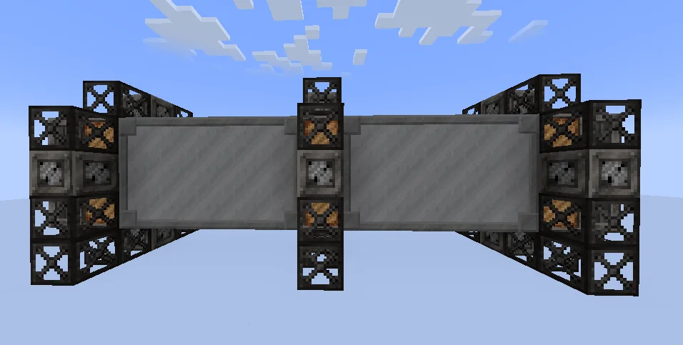
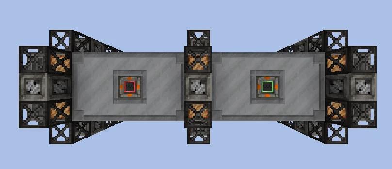
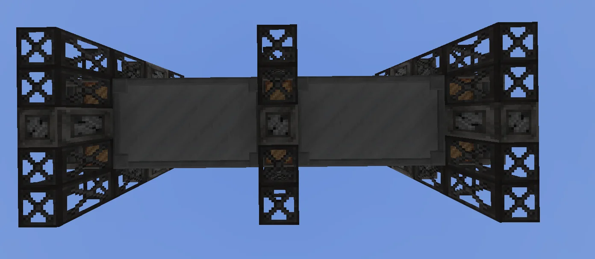
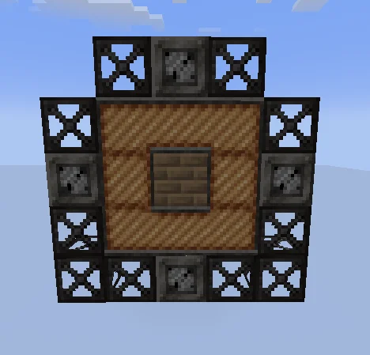
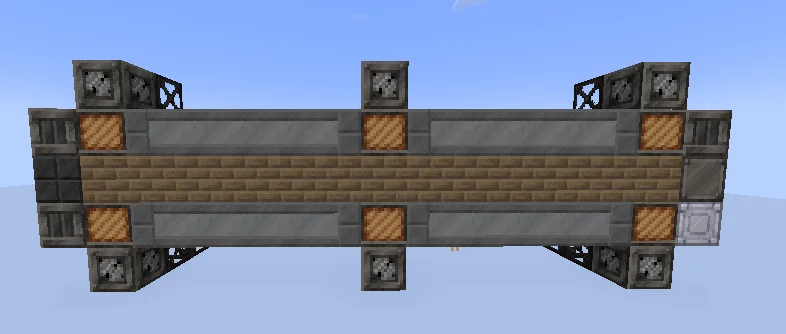

# Rotary Kiln
<small>**Submitted by:** 𝗡Ξ𝗢 (@neo_its_real) · Multiblock Design Contest, September 2026</small>

!!! quote ""

| | |
|---|---|
| **Target tier** | <HV>HV</HV>-<LuV>LuV</LuV> |
| **Role** | Processing — reduction roasting of ores and dusts |
| **Schematic** | [rotary-kiln.nbt](Contest_img/rotary-kiln/rotary-kiln.nbt) |
| **Original post** | [Rotary Kiln](https://discord.com/channels/1177211394039484477/1553130304527536148) |

## Summary

A mass material-processing multiblock for reduction roasting reactions on dusts and ores, intended as an addition to ore processing lines. It also shares some of the Pyrolyse Oven recipes. The base structure runs 4 parallels and burns a flammable gas to operate.

## Mechanics

- **Ore processing:** takes a normal ore and processes it into a refined ore, leaving some byproducts; it can also take purified ores and process them into normal ore dust, again with byproducts.
- **Chemical reactions:** takes dusts (some ore dusts, some rock dusts, or some chemical dusts) and runs reduction reactions on them, producing raw materials or inputs for other chemical lines.
- **Shared recipes:** some Pyrolyse Oven recipes are also available in the kiln.
- **Fuel:** a flammable gas is required for operation; depending on which gas is used, less of it may be needed.
- **Coil speed boost:** coils one tier above the energy hatch tier give a speed boost. The author states these boosts can accumulate up to 3x, and that they only stack if the coils are 3 tiers above the current energy hatch tier.
- **Parallels:** the base multiblock runs 4 parallels, which can be raised with Parallel Control Hatches or by increasing the energy tier.

## Structure

A long horizontal drum of Black Steel Casings capped with Steel Gearboxes and braced by Black Steel Frames at both ends and the middle, with a Cupronickel Coil and Firebrick core; the controller sits in the center of one end face and the energy, muffler, and maintenance hatches on the other, with the item buses on top. The author did not state the dimensions; the schematic is 15 x 5 x 5.

!!! abstract "Screenshots"

    === "Controller end"
        

    === "Hatch end"
        

    === "Side"
        

    === "Top"
        

    === "Bottom"
        

    === "Cross-section"
        

    === "Side cutaway"
        

## Files

- [rotary-kiln.nbt](Contest_img/rotary-kiln/rotary-kiln.nbt) — structure block (NBT) schematic, 15 x 5 x 5
