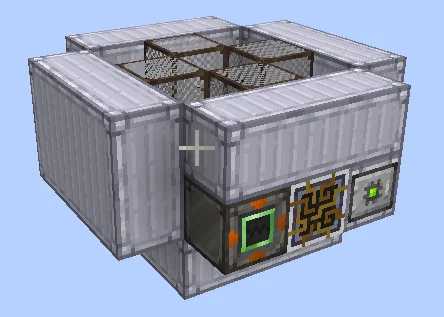
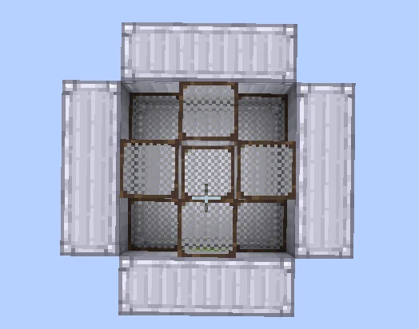
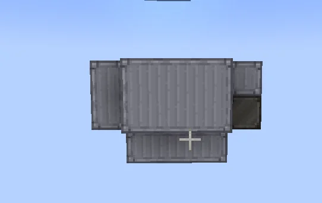

# Sieving Apparatus
<small>**Submitted by:** ArcadeGamer62 (@arcadegamer62) · Multiblock Design Contest, September 2026</small>

!!! quote ""

| | |
|---|---|
| **Target tier** | <HV>HV</HV> |
| **Role** | Processing — throughput-boosted multiblock Sieve |
| **Schematic** | [sieving-apparatus.litematic](Contest_img/sieving-apparatus/sieving-apparatus.litematic) |
| **Original post** | [Sieving Apparatus](https://discord.com/channels/1177211394039484477/1555111459745431564) |

## Summary

A multiblock version of the Sieve with boosted throughput. In addition to the normal sieve recipes, it can also run the waterlogged sieve recipes.

## Mechanics

- Runs the sieve recipes at a higher throughput than the single-block machine; the author did not give a parallel count or speed figure.
- Can also run the waterlogged sieve recipes.

## Structure

A squat, bowl-shaped structure of light-gray casings laid out in a plus shape, with a 3x3 grid of sieve meshes set into the open top and the controller and hatches on one of the outer faces. The author notes that it looks like a bowl, which they consider a good thing. Dimensions were not stated.

!!! abstract "Screenshots"

    === "Front"
        

    === "Top view"
        

    === "Bottom"
        

## Files

- [sieving-apparatus.litematic](Contest_img/sieving-apparatus/sieving-apparatus.litematic) — Litematica schematic
