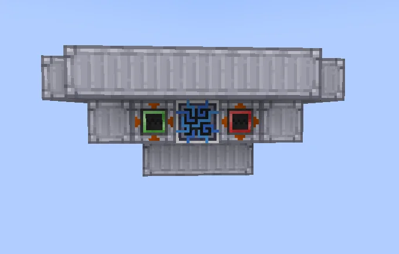
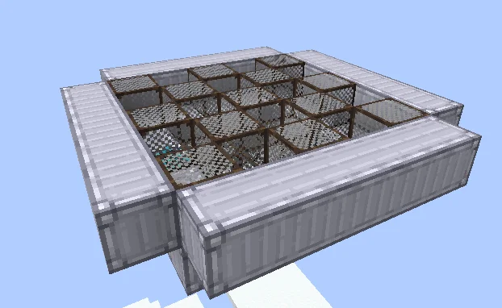
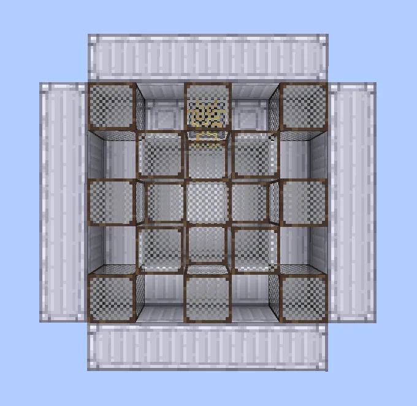

# Sieving in Extraordinaire Velocity and Efficiency (S.I.E.V.E.)
<small>**Submitted by:** kalaribot (@kalaribot_), ArcadeGamer62 (@arcadegamer62) · Multiblock Design Contest, September 2026</small>

!!! quote ""

| | |
|---|---|
| **Target tier** | <HV>HV</HV> |
| **Role** | Processing — throughput-boosted Sieve with waterlogged recipes |
| **Schematic** | [sieve.nbt](Contest_img/sieving-in-extraordinaire-velocity-and-efficiency/sieve.nbt) |
| **Original post** | [sieving in extraordinaire velocity and efficiency (S.I.E.V.E.)](https://discord.com/channels/1177211394039484477/1555275601730871326) |

!!! warning "Incomplete submission"

    The post consists of the one-line functional summary, three screenshots, and a schematic. The authors did not state how large the throughput boost is, how many parallels it runs, or how the waterlogged recipes work.

## Summary

A multiblock sieving mechanism with boosted throughput that is also able to process waterlogged recipes.

## Mechanics

- Sieving with a throughput boost over the single-block machine; the amount of the boost was not stated.
- Able to process waterlogged recipes.

## Structure

Per the schematic, a 7x3x7 structure of Clean Machine Casings with a 5x5 lattice of mesh blocks in the middle layer; the controller sits in the center of the front wall with an <HV>HV</HV> input bus and output bus either side of it.

!!! abstract "Screenshots"

    === "Front"
        

    === "Angled"
        

    === "Top"
        

## Files

- [sieve.nbt](Contest_img/sieving-in-extraordinaire-velocity-and-efficiency/sieve.nbt) — NBT structure schematic (added by the author two minutes after the post)
