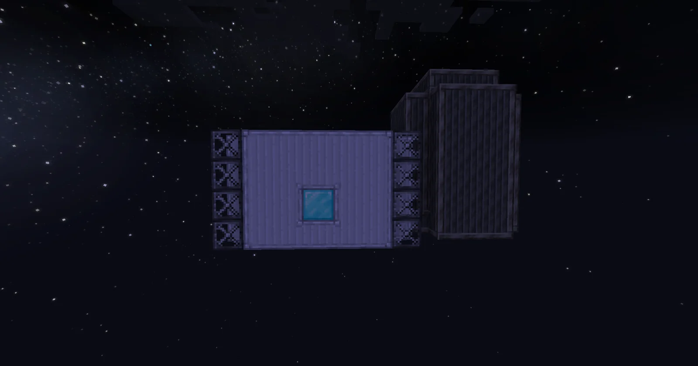
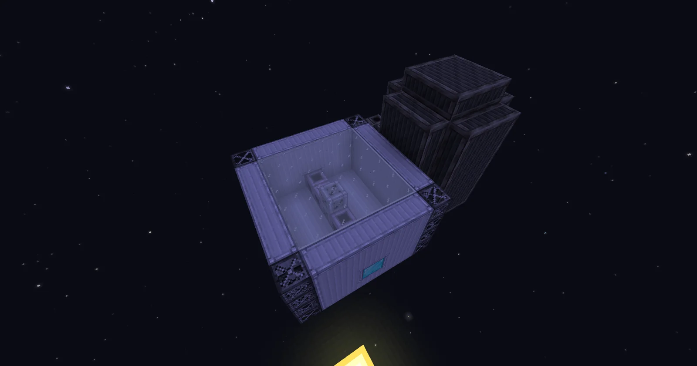
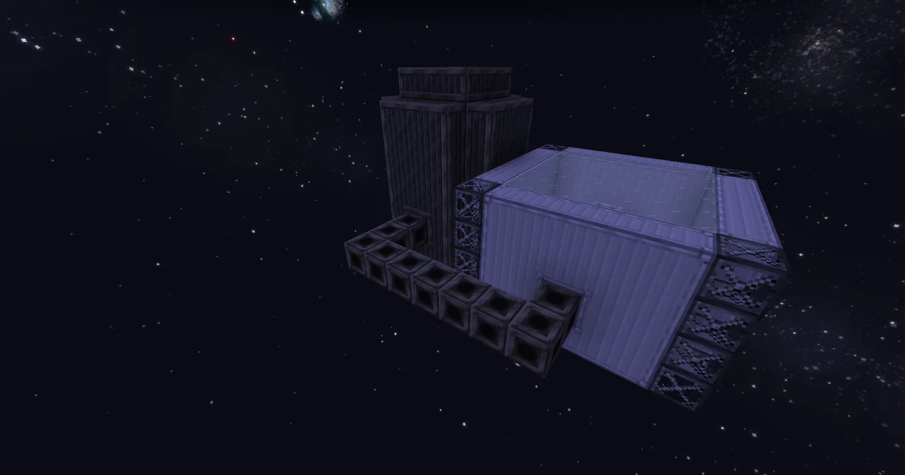

# Slurry Leaching Ore Plant (S.L.O.P.)
<small>**Submitted by:** Zepher (@zepher2951) · Multiblock Design Contest, September 2026</small>

!!! quote ""

| | |
|---|---|
| **Target tier** | <HV>HV</HV>/early <EV>EV</EV> minimum |
| **Role** | Processing — leaches specific ore slurries into dusts |
| **Schematic** | [slop.nbt](Contest_img/slurry-leaching-ore-plant/slop.nbt) |
| **Original post** | [Slurry leaching ore plant [S.L.O.P.]](https://discord.com/channels/1177211394039484477/1554054975573987368) |

## Summary

A mid-game multiblock that processes specific ore slurries into a large quantity of their primary output plus some additional dusts. Each run needs a large amount of slurry up front, and raw ore slurry is deliberately excluded.

## Mechanics

- Takes specific ore slurries as input and outputs a large quantity of the primary product together with some additional dusts.
- Requires a large amount of ore slurry (30,000 mB) to start processing. The author chose this amount to make the recipe more involved.
- Cannot process raw ore slurry or its outputs; the author wants the machine limited to specific ore slurries, but notes this restriction may be subject to change.
- Motivation: the author noticed that the Ruby, Sapphire and Green Sapphire slurries in the pack are not used by players to obtain Titanium and other dusts, and proposes this multiblock as a way to give them a use. They also suggest introducing more slurries to obtain other materials through it.

## Structure

An open-topped rectangular basin of pale casings with dark frame columns at the corners, with a taller dark tower and a row of cube-shaped blocks attached to one side; the controller sits in the middle of the front wall. In the screenshots and schematic a Diamond Block stands in for the controller. The author did not state the dimensions.

!!! abstract "Screenshots"

    === "Front"
        

    === "Top view"
        

    === "Back"
        

## Files

- [slop.nbt](Contest_img/slurry-leaching-ore-plant/slop.nbt) — structure block (NBT) schematic; the controller position is marked with a Diamond Block
