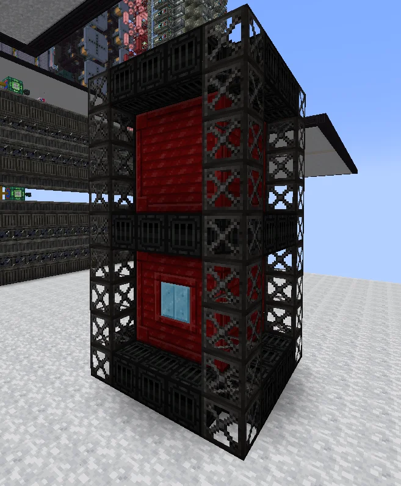

# Small Modular Nuclear Reactor (SMNR)
<small>**Submitted by:** matialox (@matialox), Haribo · Multiblock Design Contest, September 2026</small>

!!! quote ""

| | |
|---|---|
| **Target tier** | <UHV>UHV</UHV> |
| **Role** | Power generation — compact late-game nuclear reactor |
| **Schematic** | [smnr.nbt](Contest_img/small-modular-nuclear-reactor/smnr.nbt) |
| **Original post** | [Small Modular Nuclear Reactor](https://discord.com/channels/1177211394039484477/1554144811005513849) |

!!! warning "Incomplete submission"

    The post gives only a one-line functional summary. No fuel, output figures, dimensions, or in-depth mechanics were provided.

## Summary

A late-game nuclear reactor that works like a normal nuclear reactor but is much smaller. The authors intend it to produce more power than a regular reactor, so that it serves as a good, or at least decent, power source at <UHV>UHV</UHV>.

## Mechanics

- Behaves like a normal nuclear reactor, in a much smaller footprint.
- Proposed to generate more power than a regular reactor; no figures were given.
- The authors cite a real-life small modular reactor (containment vessel, reactor pressure vessel, nuclear core, hot leg riser) as the inspiration for the design.

## Structure

A narrow vertical tower: red casing walls wrapped in a dark steel frame with lattice-style corner columns, a window near the base, and a casing band splitting it into two stacked segments. The authors did not state the dimensions.

!!! abstract "Screenshots"

    === "Front"
        

## Files

- [smnr.nbt](Contest_img/small-modular-nuclear-reactor/smnr.nbt) — structure block (.nbt) schematic

## Notes from the thread

- A contest organizer asked the author to post any unrelated multiblocks as separate threads; the author renamed the entry from "Small Module Nuclear Reactor" to "Small Modular Nuclear Reactor" in response.
