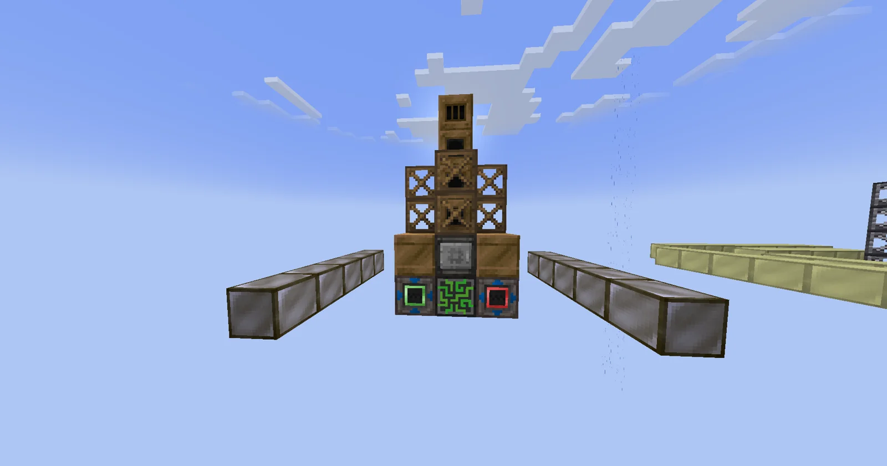
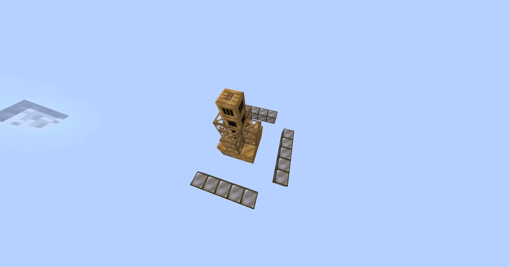
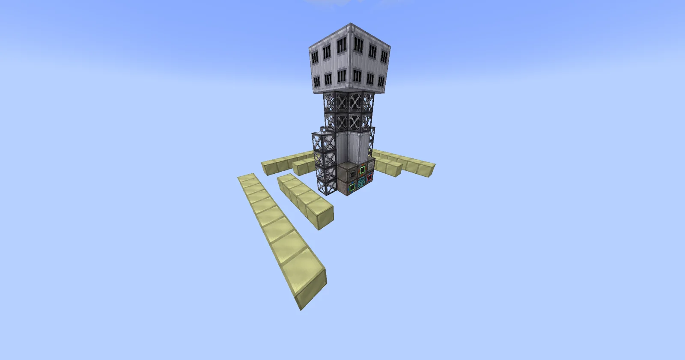
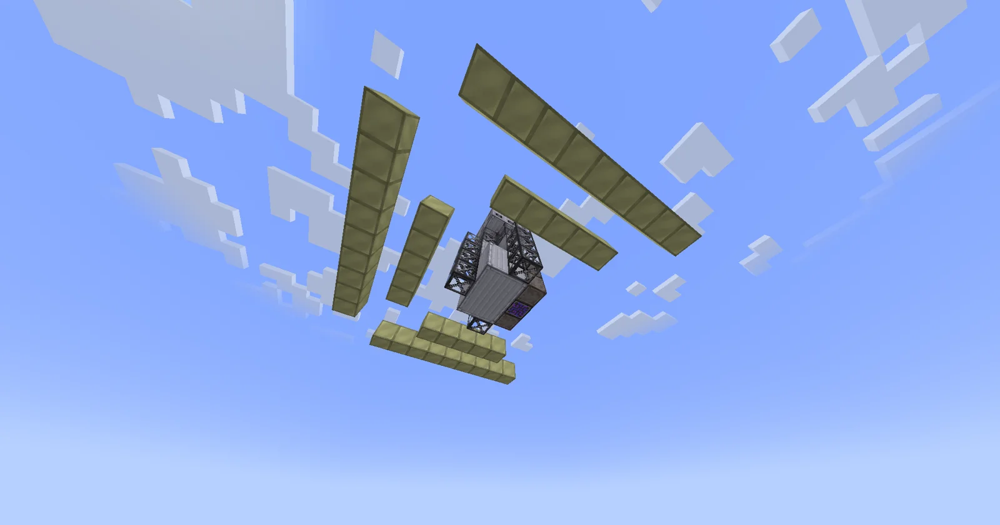

# Solar Array of Mirrors for Steam (SAMS) and Giant Lumium Overheater of Water (GLOW)
<small>**Submitted by:** Nuusku (@nuusku_) · Multiblock Design Contest, September 2026</small>

!!! quote ""

| | |
|---|---|
| **Target tier** | <LV>LV</LV> (SAMS) and <HV>HV</HV> (GLOW) |
| **Role** | Multi-structure family — fuel-free steam boilers, solar and Lumium-powered |
| **Schematic** | [sams.json](Contest_img/solar-array-of-mirrors-and-lumium-overheater/sams.json), [glow.json](Contest_img/solar-array-of-mirrors-and-lumium-overheater/glow.json) |
| **Original post** | [SAMS (Solar Array of Mirrors for Steam) and GLOW (Giant Lumium Overheater of Water)](https://discord.com/channels/1177211394039484477/1553867286043959388) |

## Summary

Two multiblocks that produce a sizable amount of steam without consuming any fuel. The steam can feed steam-powered multiblocks or be turned into power with a steam turbine.

- **Solar Array of Mirrors for Steam (SAMS)** — <LV>LV</LV>, takes Water and makes steam from sunlight, so it only runs during the day.
- **Giant Lumium Overheater of Water (GLOW)** — <HV>HV</HV>, takes Distilled Water and makes steam much faster, around the clock, from the glow of Lumium.

## Mechanics

- Neither structure needs a fuel source.
- **SAMS** takes Water as input and outputs steam, at a rate the author suggests of about **400 mB/t during the day**.
- **GLOW** takes Distilled Water and produces steam much faster, around **4,000 mB/t** (author's estimate). It works all the time, since it is powered by the glow from Lumium.
- Before the GLOW can start working it has to be loaded with a large amount of graphite to capture the heat; the author suggests roughly **100 Graphene Dust**.

## Solar Array of Mirrors for Steam (SAMS)

### Summary

The <LV>LV</LV> entry: a small bronze tower whose controller, input hatch, and output hatch sit in the bottom row of the front wall, flanked by rows of Silver Blocks laid flat on the ground as mirrors. The template is built from Bronze Machine Casings, Bronze Frames, Bronze Pipe Casings, one Bronze Firebox Casing, and 15 Silver Blocks. The author did not state the dimensions; the template spans 7x6x9.

### Screenshots

!!! abstract "Screenshots"

    === "Front"
        

    === "Top view"
        

### Files

- [sams.json](Contest_img/solar-array-of-mirrors-and-lumium-overheater/sams.json) — Building Gadgets template (JSON) of the SAMS

## Giant Lumium Overheater of Water (GLOW)

### Summary

The <HV>HV</HV> entry: a taller stainless steel tower with the controller, hatches, input bus, and muffler at its base, surrounded by rows of Lumium Blocks laid flat on the ground in the same way as the SAMS mirrors. The template is built from Stainless Steel Frames, Clean Machine Casings, Stainless Steel Firebox Casings, PTFE Pipe Casings, and 42 Lumium Blocks. The author did not state the dimensions; the template spans 11x8x13.

### Screenshots

!!! abstract "Screenshots"

    === "Front"
        

    === "Underside"
        

### Files

- [glow.json](Contest_img/solar-array-of-mirrors-and-lumium-overheater/glow.json) — Building Gadgets template (JSON) of the GLOW

## Structure

Both share the same layout: a central tower holding the controller and hatches, with the heat-collecting blocks (Silver Blocks for the SAMS, Lumium Blocks for the GLOW) spread out flat around it. In both templates the controller position is filled by a placeholder block.

## Files

- [sams.json](Contest_img/solar-array-of-mirrors-and-lumium-overheater/sams.json) — Building Gadgets template (JSON) of the Solar Array of Mirrors for Steam
- [glow.json](Contest_img/solar-array-of-mirrors-and-lumium-overheater/glow.json) — Building Gadgets template (JSON) of the Giant Lumium Overheater of Water
