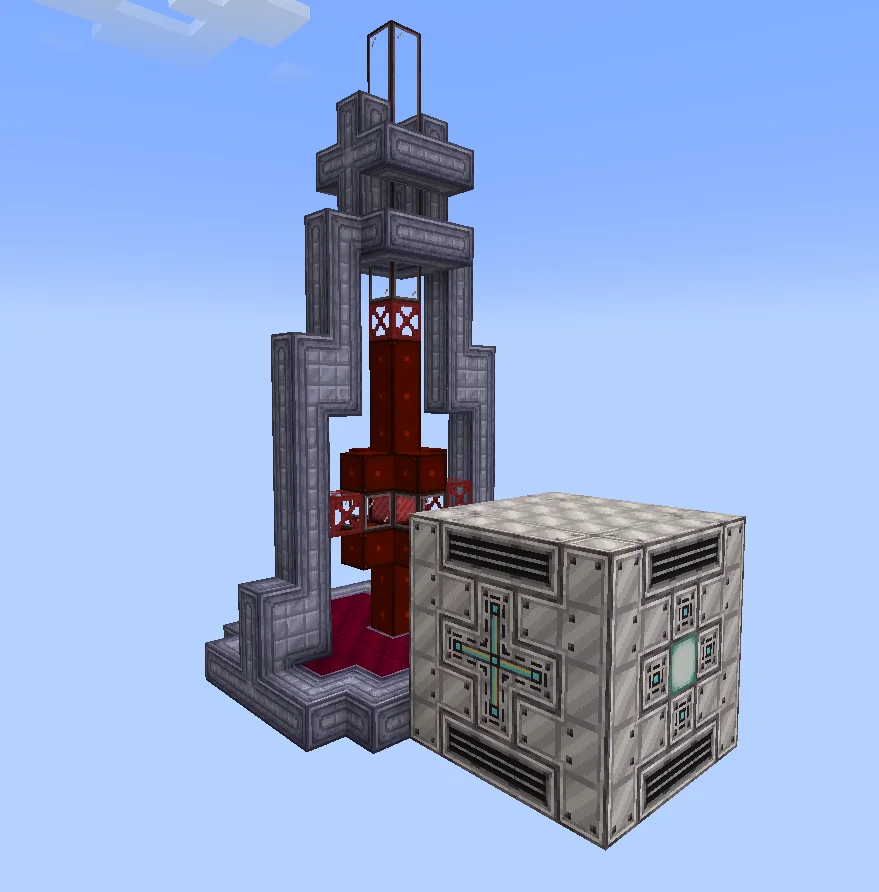

# Solar Plasma Extractor (SPEx)
<small>**Submitted by:** TheSkadoodler (@rythebreadloaf) · Multiblock Design Contest, September 2026</small>

!!! quote ""

| | |
|---|---|
| **Target tier** | <UHV>UHV</UHV> |
| **Role** | Power generation — laser that extracts burnable plasma from the sun |
| **Schematic** | [spex.nbt](Contest_img/solar-plasma-extractor/spex.nbt) |
| **Original post** | [Solar Plasma Extractor](https://discord.com/channels/1177211394039484477/1554598676532297728) |

## Summary

A high-powered laser beam aimed at the stars themselves, leeching plasma from them for the player's use. It generates light plasmas such as Hydrogen and Helium plasma that can be burnt for a net power profit.

## Mechanics

- Only operates when built in Abydos.
- Consumes a massive amount of power to bombard the sun with photons, producing a large quantity of light plasmas (e.g. Hydrogen plasma, Helium plasma).
- The machine's precision requires computation as an input in order to run.
- The author states the machine makes a net profit in plasma, so the output can be burnt to power the base.
- The controller replaces the sea lantern in the schematic.

## Structure

A tall gray tower of casings framing a red glass-and-block core column, standing on a red base plate, with a separate cube-shaped block shown beside it; the sea lantern on the cube marks the controller position. The author did not state the dimensions.

!!! abstract "Screenshots"

    === "Overview"
        

## Files

- [spex.nbt](Contest_img/solar-plasma-extractor/spex.nbt) — NBT structure schematic (controller goes where the sea lantern is)
