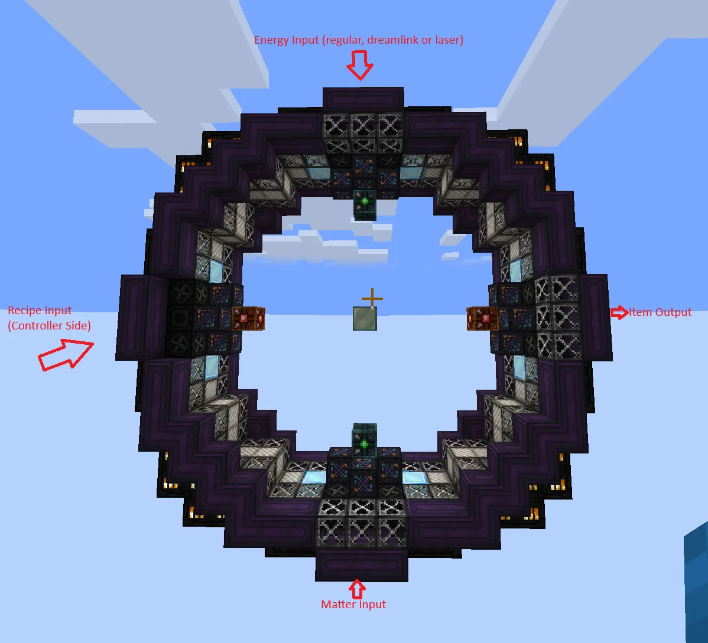
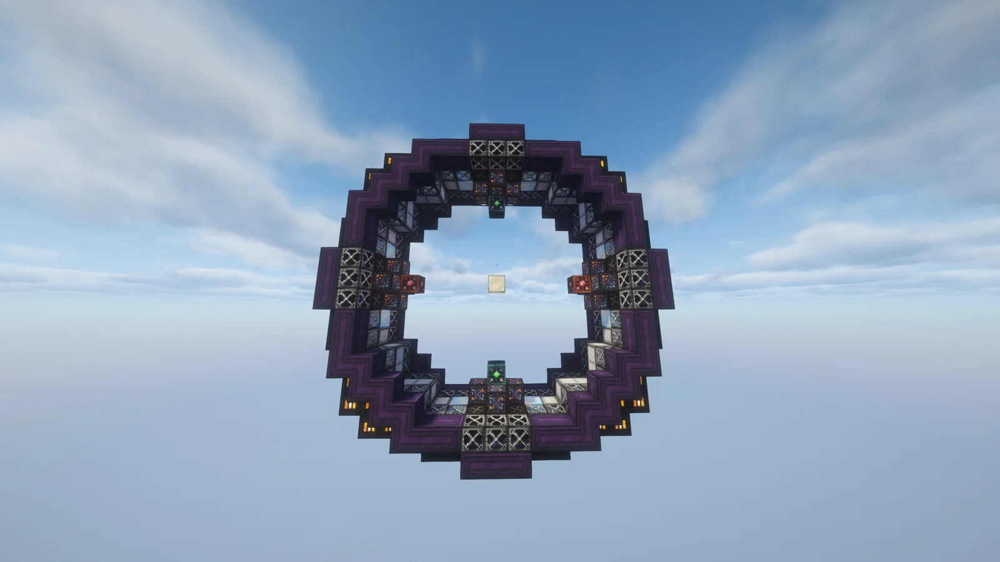
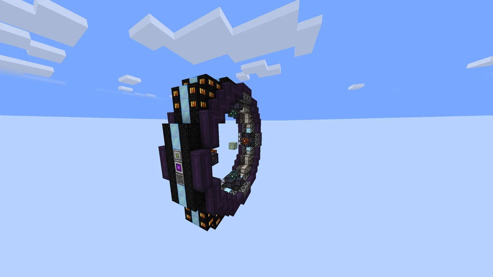
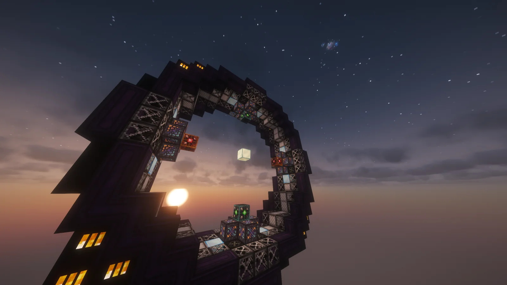
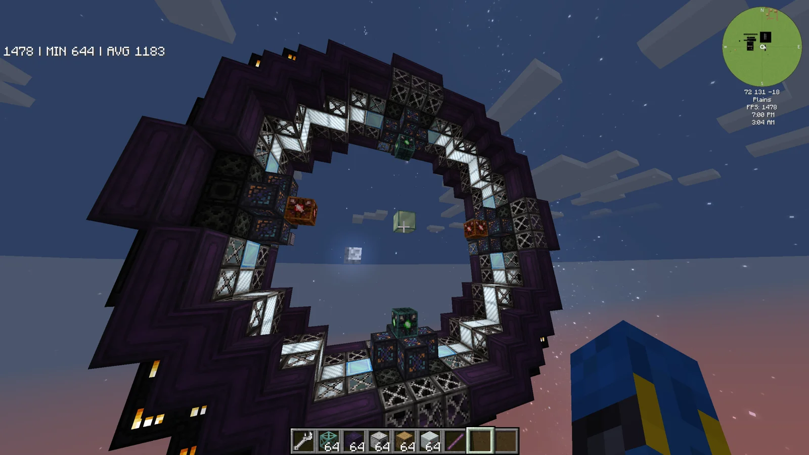
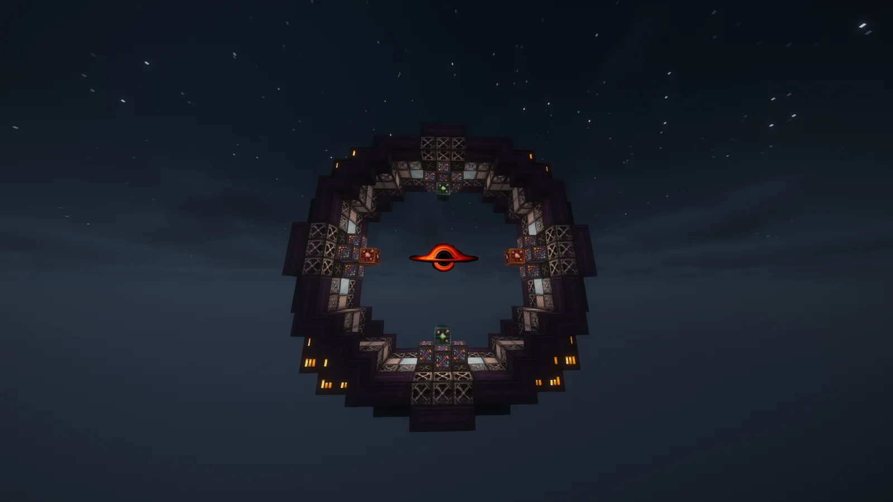

# Stabilised Artificial Singularity Harvester (S.A.S.H.)
<small>**Submitted by:** Kenobi (@kenobi0202) · Multiblock Design Contest, September 2026</small>

!!! quote ""

| | |
|---|---|
| **Target tier** | <UHV>UHV</UHV> (post ASG, pre HF) |
| **Role** | Processing — black hole compression and high-tier material synthesis |
| **Schematic** | [sash-template.txt](Contest_img/stabilised-artificial-singularity-harvester/sash-template.txt) |
| **Original post** | [S.A.S.H. (Stabilised Artificial Singularity Harvester)](https://discord.com/channels/1177211394039484477/1553930054885572718) |

## Summary

A 17x17x5 ring-shaped machine that contains an artificial black hole and uses its "gravitation/compression" theme to run three categories of recipes: a TNT-free Implosion Compressor alternative, Heat Chamber and Pressure Heat Chamber recipes, and a new route to <UEV>UEV</UEV>/<UIV>UIV</UIV> progression materials (and potentially <UXV>UXV</UXV> materials, should the pack ever get that far) so that not every late-game material has to come from the HF.

Unlike most machines, which are balanced by recipe duration, the S.A.S.H. is balanced by **exponentially increasing energy demand in exchange for high throughput**: every recipe completes in exactly one cycle, and the cost is the energy needed to keep the black hole contained. The author describes it primarily as an automation challenge with "a little bit of maths": the black hole follows the real-world geometric equations of a sphere, and the player has to calculate how much matter to feed it.

The author notes that easymode (@easyymode) published a somewhat similar design earlier, but decided to publish this one anyway since the mechanics write-up was already half done, and that the focus was on designing the mechanics rather than the build itself (which they invite others to change).

## Mechanics

### Hatches and structure rules

- Four **location-specific** hatches/buses, one at each of the four "injector" protrusions of the ring: Energy Input, Recipe Input (controller side), Recipe Output (item output), and Matter Input (items). Fixed positions avoid unwanted recipe conflicts.
- Accepts all kinds of energy hatches, including laser (the annotated screenshot lists "regular, dreamlink or laser").
- Maintenance hatches and Variadic interfaces can replace any Superalloy Casing. Variadics get output options for the machine's unique values (see below).
- Cannot take parallel hatches.
- In the submitted build the AE2 ME Controller stands in for the controller block.
- The author imagines a render of a black hole in the center of the ring, most easily done as a 2D render that rotates to face the player, which they suggest is "somewhat accurate" to how a real black hole bends light.

### Initial startup

- The machine requires an initial startup before a black hole exists. The author proposes this be a time/energy sink rather than resource-intensive: for example, feeding it only 2A of <UHV>UHV</UHV> would make the startup take 10 hours, heavily incentivizing higher-tier (and laser) hatches. The startup would have Progress on Completion (POC).
- Once startup completes, a black hole forms in the center with a base **Schwarzschild radius**, shown in the controller and exposable via Variadics.

### Radius, surface area, and volume

The black hole is modeled as a sphere, so radius, surface area (4πr²), and volume (4/3 πr³) are tied together:

- **Radius** decreases passively by a set amount each cycle (a cycle being 1–5 seconds, left to implementation/performance considerations). As a harder alternative, the author suggests a relative reduction based on the current radius instead of an absolute one. If the radius falls below a minimum, the black hole collapses and the player must redo the initial startup.
- **Volume** increases by an absolute amount for each item inserted into the Matter Input bus; all items in that bus are consumed at the start of every cycle. The author suggests the matter item be cheap (for example Cobblestone or AE2 Matter Balls), since the challenge is automation, not resource cost.
- **Containment** is a constant energy cost, paid whether a recipe is running or the machine is idle, that scales with volume, so energy demand grows exponentially with radius. If the containment cost exceeds what the energy hatch can supply, the black hole implodes and **the controller block is destroyed**, so overfeeding matter must be avoided at all costs.

### Recipe mechanics

- Every recipe has a minimum and maximum **surface area** required to run. For additional difficulty, the author proposes voiding recipe inputs that are inserted while the surface area is outside that window.
- When a recipe starts, the surface area is reduced by a set amount per recipe; this reduction stacks additively with each parallel. All recipes take exactly one cycle.
- Parallels are uncapped except by the black hole itself: the machine only runs as many parallels as it can before `CurrentSurfaceArea - SurfaceAreaReduction` would drop to the surface area at the minimal radius (the radius right after initial startup).

### Proposed recipe categories

1. **Implosion Compressor "skips"** (low surface area, accessible and sustainable right away): a more resource-efficient Implosion Compressor that needs no TNT and outputs gems at a 1:1 dust:gem ratio instead of the Implosion Compressor's 4:3.
2. **Heat Chamber and Pressure Heat Chamber recipes** (medium surface area, similar idea to easymode's design): more energy-expensive than the compressor recipes but still manageable, and attractive because everything finishes in one cycle. The author also suggests a Neutronium recipe as thematically fitting and a way to reduce fusion spam.
3. **High surface area recipes**: extremely energy-expensive, and the only way to obtain certain materials used in <UEV>UEV</UEV>/<UIV>UIV</UIV> progression (or <UXV>UXV</UXV> if the pack develops that far). This would reduce the reliance on the HF for late-game materials and add gameplay variety.

### The automation challenge

Because containment cost grows exponentially with volume, the player has to reach the target volume for a recipe by inserting exactly the right number of matter items, let the machine idle when there is nothing to run (to stop it from burning energy for nothing), and still keep enough matter flowing to stop the black hole from shrinking to its minimum size and collapsing, since a restart is expensive and slow. The author expects ME Replenishers plus toggle buses to be the tool for this, combined with extensive Variadic Interface integration for precise redstone logic, and additional logic to cut or enable recipe inputs if the input-voiding rule is implemented.

### Balance note

The author stresses that recipes and their surface area requirements would need very careful balancing: the scaling energy demand can make the machine either hugely overpowered (fixed one-cycle durations with huge parallel counts) or practically impossible to run (for example by exceeding the EU/t of the highest-tier laser hatch available at that stage).

## Structure

A hollow ring, 17x17x5, built mainly from Enriched Naquadah casings, Superalloy Casings, Atomic Casings, Neutronium Frames, and Superconducting Coils (see the block list below), with four hatch "injectors" protruding from the ring at the top, bottom, left, and right. The controller (an ME Controller placeholder in the submitted build) sits on the Recipe Input side of the ring, off-center.

!!! abstract "Screenshots"

    === "Hatch layout"
        

    === "Front"
        

    === "Side"
        

    === "Angled"
        

    === "Active state"
        

    === "Render mockup"
        

??? note "Block list from the template"

    | Block | Count |
    |---|---|
    | Atomic Casing | 112 |
    | Neutronium Frame | 85 |
    | Enriched Naquadah Machine Casing | 72 |
    | Superalloy Casing | 54 |
    | Enriched Naquadah Firebox Casing | 40 |
    | Superconducting Coil | 28 |
    | Enriched Naquadah Pipe Casing | 24 |
    | Enriched Naquadah Engine Intake Casing | 16 |
    | Runic Transportation Casing | 8 |
    | Runic Stabilization Casing | 8 |
    | Lepton Coalescing Superalloy Frame | 2 |
    | Laser Casing | 2 |
    | Inscribe Casing | 2 |
    | ME Stocking Input Bus | 2 |
    | ME Controller (controller placeholder) | 1 |
    | Nether Star Block | 1 |
    | UIV 4096A Laser Target Hatch | 1 |
    | Dual ME Output Hatch (Expanded GT) | 1 |
    | Auto Maintenance Hatch | 1 |

## Files

- [sash-template.txt](Contest_img/stabilised-artificial-singularity-harvester/sash-template.txt) — block-state template dump (JSON with a block list and required item counts, saved as a .txt)

## Notes from the thread

- Serotonintheft (@serotonintheft) disliked that the controller is forced off-center and suggested moving it to replace one of the Atomic Casings on the sides, at the top or bottom; the author agreed the symmetry is broken but did not post a revised build.
- Kolja (@kolja_) replied with a render of the black hole concept (not saved with this entry); the author said it looked better than their own mockup.
