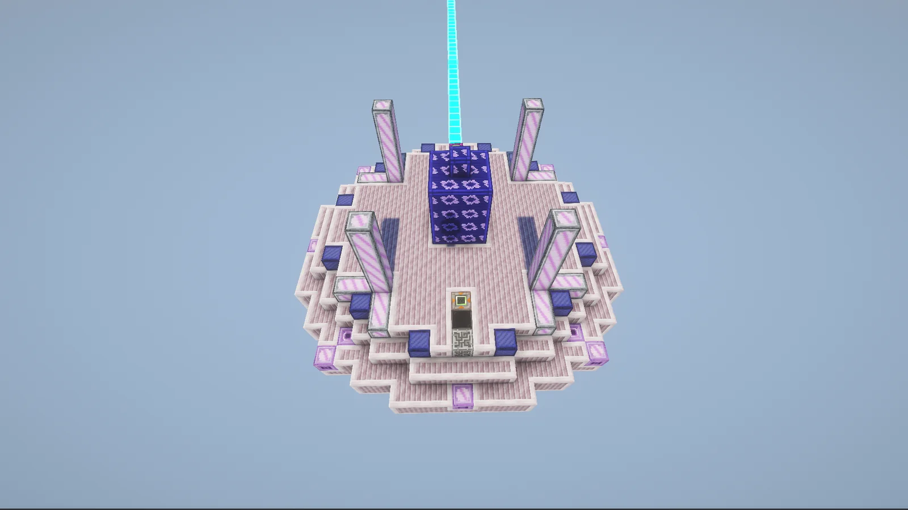
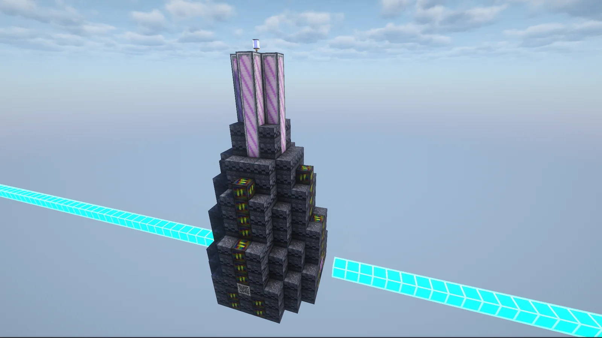
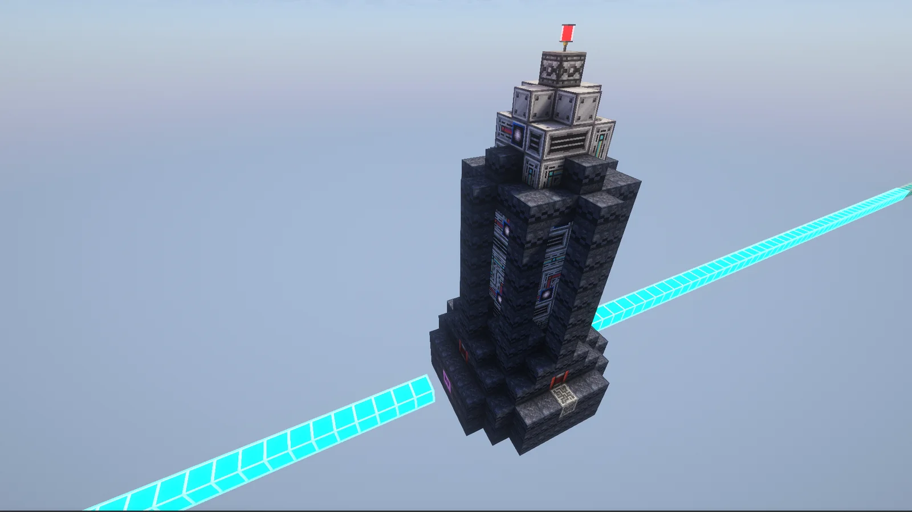
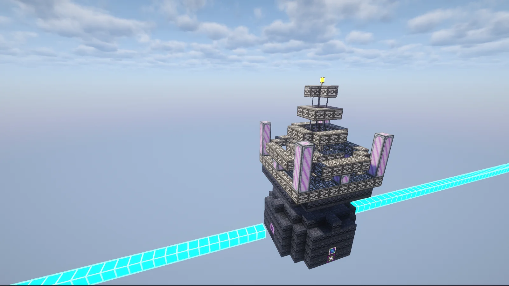
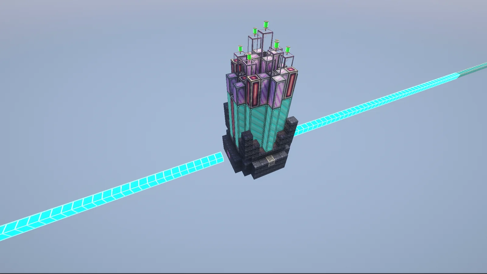
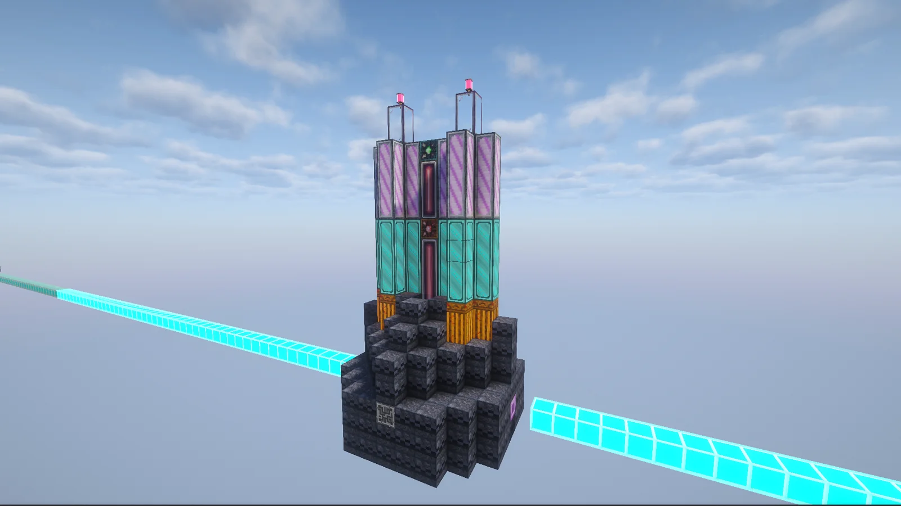
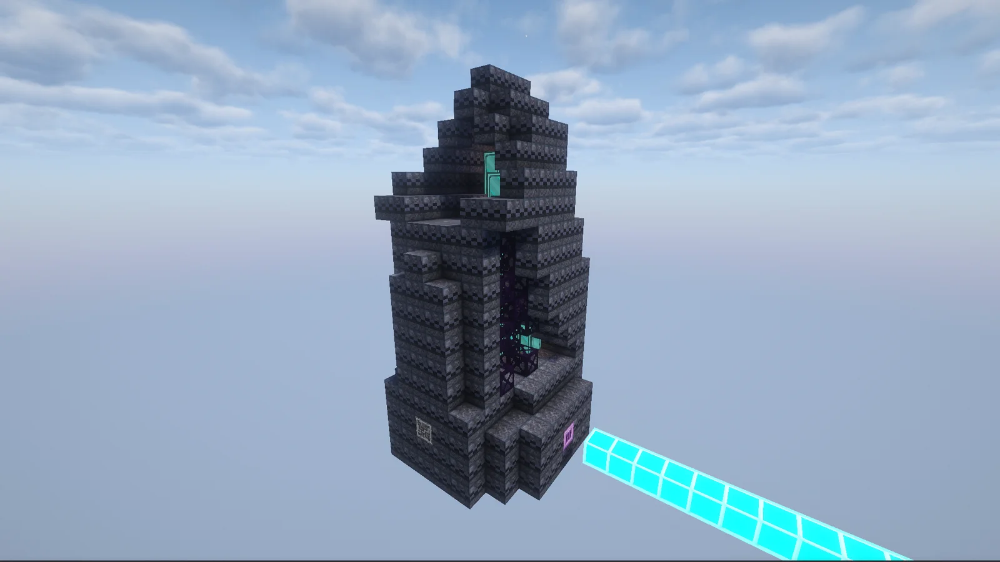
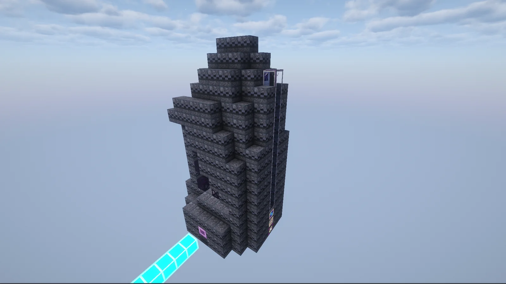
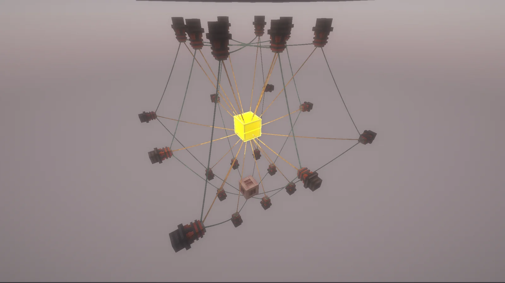

# Star Breeding
<small>**Submitted by:** White tea (@whitetriethylamine), credited together with the dev team · Multiblock Design Contest, September 2026</small>

!!! quote ""

| | |
|---|---|
| **Target tier** | <UXV>UXV</UXV> (whole family) |
| **Role** | Multi-structure family — production and processing of living stars |
| **Schematic** | [SBB.litematic](Contest_img/star-breeding/sbb.litematic), [LFF.litematic](Contest_img/star-breeding/lff.litematic), [SHPLT.litematic](Contest_img/star-breeding/shplt.litematic), [SFN.litematic](Contest_img/star-breeding/sfn.litematic), [SWGA.litematic](Contest_img/star-breeding/swga.litematic), [DCS.litematic](Contest_img/star-breeding/dcs.litematic), [MDRI.litematic](Contest_img/star-breeding/mdri.litematic) |
| **Original post** | [Star breeding](https://discord.com/channels/1177211394039484477/1555060970148069446) |

## Summary

A family of seven <UXV>UXV</UXV> multiblocks that handles the production and processing of stars. A **Stellar Breeding Base (SBB)** locks a star seed in place and links the other modules to it: a **Laser Friction Feeder (LFF)** feeds the star mass, a **Stellar High-Power Laser Therapy (SHPLT)** speeds up its digestion, a **Star Force Neutralizer (SFN)** keeps it stable, a **Stellar Wind Gleaning Array (SWGA)** harvests its excess mass, a **Disrupting Celestial Sabotager (DCS)** kills a rogue star in an emergency, and a **Miniature Dyson Ring Installer (MDRI)** turns the star's energy into power. The author writes the descriptions as if the stars are alive, and asked for questions since they felt the mechanics were not explained fully.

## Mechanics

The author's `General_Information.txt` describes a shared star lifecycle that all modules act on.

**Lifecycle**

- There are various types of star seeds. Any star seed in the base's input bus will be used.
- A star seed starts with 500 stability. Each rank up reduces the maximum attainable stability, but this is not a hard cap, so a star can keep a previous, higher stability value.
- Stability decays passively; higher rank stars decay faster.
- Feeders add **initial mass**, which is gradually digested into **normal mass**.
- Harvesters turn normal mass into byproducts.
- If both initial mass and normal mass are 0, the star is considered dead. Harvesters collect the cores of dead stars.
- If the base multiblock is unformed, or if the star is not dead by the time its stability reaches 0, everything in a spherical radius that reaches partway into the multiblocks is deleted.

**Rank**

- Stars cannot go down in rank.
- A star's density is based on its amount of normal mass, and its density decides its rank. Ranking up grants stability, but makes stability decay faster.
- A star can only rank up when its initial mass is 0.
- Passive stability decay depends on how close the density is to a certain value, which is decided by the rank.

**Placeholder blocks**

The schematics use stand-in blocks that the author intends to be replaced:

| Block in the schematic | Intended block |
|---|---|
| Nyanium Turbine Casing | the Mysterious Rod's blocks (from the official Dyson multiblock) |
| Unbendable Dragonsteel Casing | the Mysterious Obelisk's blocks (from the official Dyson multiblock) |
| Auxiliary Fusion Coil MK II | Auxiliary Fusion Coil MK IV |
| Advanced Fusion Coil | a higher tier of fusion coil |
| Draconic Stargate Ring Block | a new casing |
| Pallaridium | Neutronium |
| Nyanium Firebox Casing | a passthrough for the render |
| Nyanium Pipe Casing | a passthrough for the render inside the block |
| Lanterns | the color of the multiblock's render |

## Stellar Breeding Base (SBB)

### Summary

Creates a special space that efficiently traps and amplifies the energy of stars, then locks a star seed at its center where it can be processed.

### Mechanics

- Any star seeds in the input bus will be used.
- The controller block does not control anything important. Instead, it links and unlinks the related multiblocks, and it controls the renders and the build-helper highlights.
- The base contains a block that accepts scripts. These scripts can activate, deactivate, or regulate the speed of the linked multiblocks.
- The base multiblock can reduce the star's stability by itself.

### Structure

A wide, stepped, dome-like platform of pale pink casings with purple accents, striped pillars around its rim, a dark blue block stack behind the center, and the controller on the front face; a cyan beam rises from the top. The author did not state the dimensions.

!!! abstract "Screenshots"

    === "SBB front"
        

### Files

- [SBB.litematic](Contest_img/star-breeding/sbb.litematic) — Litematica schematic of the Stellar Breeding Base

## Laser Friction Feeder (LFF)

### Summary

Feeds the star its star feed, letting it digest it into stable matter that forms a rich and healthy star.

### Mechanics

- The feeder adds to the star's initial mass.
- The materials the feeder uses depend on the type of star seed.
- It can be upgraded with Advanced Fusion Coils.

### Structure

A tall, dark stepped tower studded with coil blocks, topped by a cluster of striped pillars and a small lantern. The author did not state the dimensions.

!!! abstract "Screenshots"

    === "LFF"
        

### Files

- [LFF.litematic](Contest_img/star-breeding/lff.litematic) — Litematica schematic of the Laser Friction Feeder

## Stellar High-Power Laser Therapy (SHPLT)

### Summary

Stimulates the star's digestive processes, reducing its total lifecycle and refining it into a better, stronger version of itself.

### Mechanics

- Speeds up the very slow digesting process using energy.

### Structure

A dark tower with glowing panel blocks on its sides and a white machine-block assembly on top, capped by a small red marker. The author did not state the dimensions.

!!! abstract "Screenshots"

    === "SHPLT"
        

### Files

- [SHPLT.litematic](Contest_img/star-breeding/shplt.litematic) — Litematica schematic of the Stellar High-Power Laser Therapy

## Star Force Neutralizer (SFN)

### Summary

Equalizes the various forces naturally present around stars, forcing a simulated equilibrium. Stable stars emit less force.

### Mechanics

- Uses a cheaper universal stabilizing star feed to slowly add enough stability to counteract the passive drain. It does not add mass.
- Stabilizers need to be an even number, and each needs to face another stabilizer to start working.
- It can be upgraded with Advanced Fusion Coils.

### Structure

A dark base supporting several tiers of framed casing platforms that shrink toward the top, with striped pillars at the corners and a lantern on the peak. The author did not state the dimensions.

!!! abstract "Screenshots"

    === "SFN"
        

### Files

- [SFN.litematic](Contest_img/star-breeding/sfn.litematic) — Litematica schematic of the Star Force Neutralizer

## Stellar Wind Gleaning Array (SWGA)

### Summary

Trims and collects the valuable excess mass off a star. Reckless usage can result in the death of the involved star.

### Mechanics

- Turns mass into processable materials.
- If the star drops to a certain mass, decided by the tier, it collects the core. Higher tiers produce better cores.

### Structure

A dark base with a tall bundle of teal and purple glass columns rising from it, topped by framed blocks with green indicators. The author did not state the dimensions.

!!! abstract "Screenshots"

    === "SWGA"
        

### Files

- [SWGA.litematic](Contest_img/star-breeding/swga.litematic) — Litematica schematic of the Stellar Wind Gleaning Array

## Disrupting Celestial Sabotager (DCS)

### Summary

An extreme failsafe measure that rushes to safely kill a rogue star as fast as possible. This inconsiderate method may affect the byproducts.

### Mechanics

- Drains mass at the speed of 16 harvesters, but loses most of the byproducts and produces a low quality core that is used for lower tier applications.

### Structure

A dark stepped base with a tall tower of teal and purple glass around a red central column, with two pink lanterns on top. The author did not state the dimensions.

!!! abstract "Screenshots"

    === "DCS"
        

### Files

- [DCS.litematic](Contest_img/star-breeding/dcs.litematic) — Litematica schematic of the Disrupting Celestial Sabotager

## Miniature Dyson Ring Installer (MDRI)

### Summary

Deploys dyson rings capable of harvesting the mystical energies around living stars, converting them into large amounts of power.

### Mechanics

- Higher rank stars produce more energy.
- It moves the dyson ring into a locked slot and periodically reduces its durability. When the durability reaches 0 it outputs a broken ring that cannot be fixed and has to be salvaged.

### Structure

A tall, dark stepped tower with an open cavity in its front that holds the ring, and a vertical glass channel running up the back. The author did not state the dimensions.

!!! abstract "Screenshots"

    === "MDRI front"
        

    === "MDRI back"
        

### Files

- [MDRI.litematic](Contest_img/star-breeding/mdri.litematic) — Litematica schematic of the Miniature Dyson Ring Installer

## Structure

Seven separate builds, mostly dark stepped towers with glass, coil, or framed upper sections, plus the wide pale-pink base. In the author's screenshots each module sits on a cyan beam line. The author also posted an example of the intended render: a glowing star at the center with a web of lines running out to the surrounding nodes. Per-structure screenshots are in the sections above.

!!! abstract "Screenshots"

    === "Render example"
        

## Files

- [general-information.txt](Contest_img/star-breeding/general-information.txt) — the author's lifecycle, rank, and block-replacement notes
- [SBB.litematic](Contest_img/star-breeding/sbb.litematic) — Litematica schematic of the Stellar Breeding Base
- [LFF.litematic](Contest_img/star-breeding/lff.litematic) — Litematica schematic of the Laser Friction Feeder
- [SHPLT.litematic](Contest_img/star-breeding/shplt.litematic) — Litematica schematic of the Stellar High-Power Laser Therapy
- [SFN.litematic](Contest_img/star-breeding/sfn.litematic) — Litematica schematic of the Star Force Neutralizer
- [SWGA.litematic](Contest_img/star-breeding/swga.litematic) — Litematica schematic of the Stellar Wind Gleaning Array
- [DCS.litematic](Contest_img/star-breeding/dcs.litematic) — Litematica schematic of the Disrupting Celestial Sabotager
- [MDRI.litematic](Contest_img/star-breeding/mdri.litematic) — Litematica schematic of the Miniature Dyson Ring Installer

## Notes from the thread

- Asked whether the blocks in the modules are ASG ring blocks, the author clarified they are DSG ring blocks, used as a stand-in for a new casing.
- The author also linked a short animation clip; thread members pointed out it is a dev-team sneak peek of an upcoming update rather than the author's own work, which matches the "and the dev team" credit in the post.
