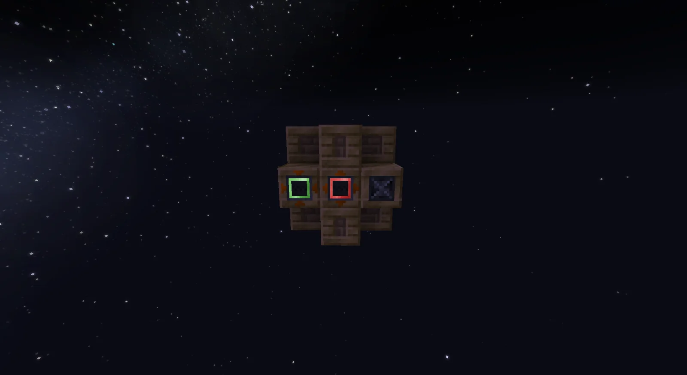
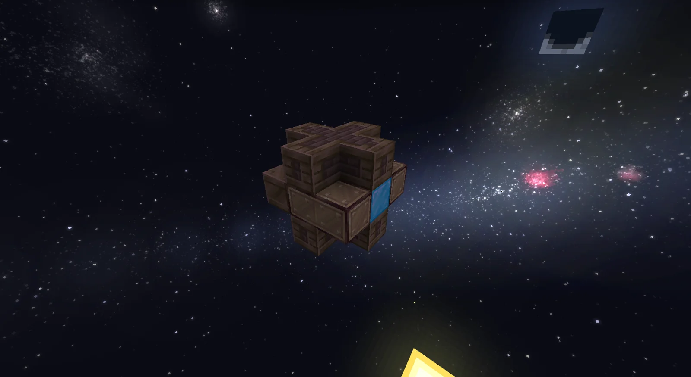

# Steam Centrifuge
<small>**Submitted by:** 54 (@54mod2) · Multiblock Design Contest, September 2026</small>

!!! quote ""

| | |
|---|---|
| **Target tier** | <ULV>ULV</ULV> |
| **Role** | Steam-age processing — steam-powered ULV Centrifuge |
| **Schematic** | [steam_centrifuge.nbt](Contest_img/steam-centrifuge/steam_centrifuge.nbt) |
| **Original post** | [Steam Centrifuge](https://discord.com/channels/1177211394039484477/1553533237115228200) |

## Summary

A steam-powered multiblock that runs <ULV>ULV</ULV> Centrifuge recipes. The author positions it as an early way to process rubber and as an alternative to the Create centrifuge.

## Mechanics

- Runs the <ULV>ULV</ULV> Centrifuge recipe set, powered by steam.
- Intended as an early-game rubber processing route and an alternative to the Create centrifuge.
- The author did not provide further mechanics details.

## Structure

A small, cross-shaped structure of wooden-framed casings; the front face holds a row of three machine blocks and a blue-faced hatch sits on one side. The author did not state the dimensions.

!!! abstract "Screenshots"

    === "Front"
        

    === "Angled"
        

## Files

- [steam_centrifuge.nbt](Contest_img/steam-centrifuge/steam_centrifuge.nbt) — NBT structure schematic
