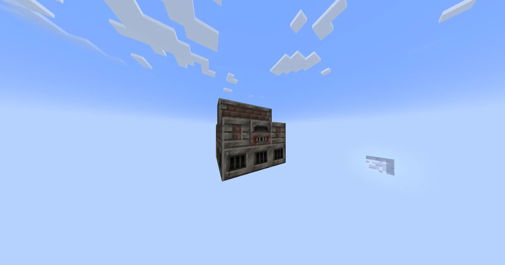
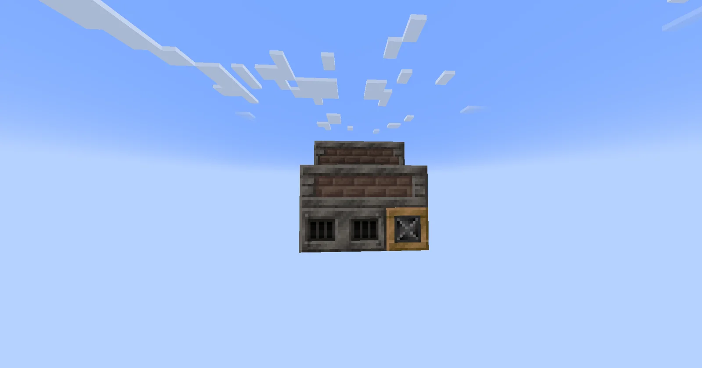
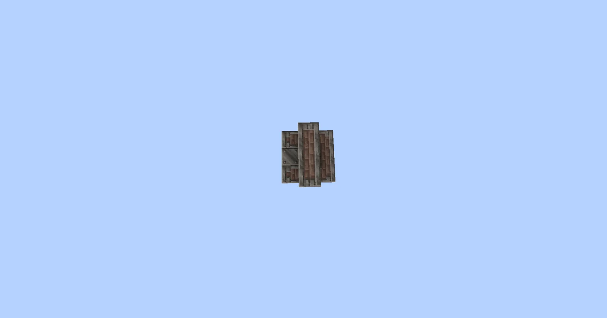

# Steam Forge
<small>**Submitted by:** Goofert | Woman in training (@goofert34) · Multiblock Design Contest, September 2026</small>

!!! quote ""

| | |
|---|---|
| **Target tier** | <ULV>ULV</ULV> |
| **Role** | Steam-age processing — parallel Alloy Smelter |
| **Schematic** | [steam_forge.nbt](Contest_img/steam-forge/steam_forge.nbt) |
| **Original post** | [Steam Forge](https://discord.com/channels/1177211394039484477/1552818501838970961) |

## Summary

A steam multiblock version of the Alloy Smelter. The author's intent is to give the Alloy Smelter the same steam-multi treatment that the other steam multiblocks already have, making alloys easier to produce early on.

## Mechanics

- Works as an Alloy Smelter.
- Runs **8 parallels**.

## Structure

A small brick-and-steel steam structure with hatches on one face and the controller on the other, in the same size class as the existing steam multis according to the author; exact dimensions were not stated.

!!! abstract "Screenshots"

    === "Front"
        

    === "Hatch side"
        

    === "Top view"
        

## Files

- [steam_forge.nbt](Contest_img/steam-forge/steam_forge.nbt) — NBT structure file

## Notes from the thread

- Several replies felt the structure was too small and should be bigger; the author answered that it is as large as the other steam multis.
- One commenter questioned whether the idea was original, since a similar steam Multi Alloy Smelter exists in TFG (and Monifactory). Others considered it small and basic enough to be a coincidence; a later reply clarified that the TFG structure looks different only because steam multis there require Bronze Casings.
