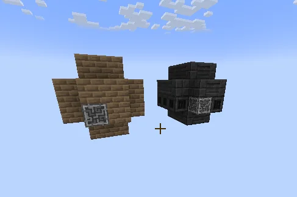
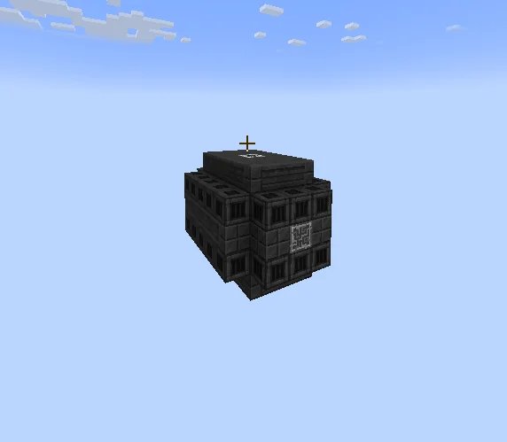

# Steam Glassworks and Glass Factory
<small>**Submitted by:** Shadow (@shadowcrossbinder) · Multiblock Design Contest, September 2026</small>

!!! quote ""

| | |
|---|---|
| **Target tier** | Steam Glassworks: <ULV>ULV</ULV> (steam) · Glass Factory: <LV>LV</LV> to around <LuV>LuV</LuV> |
| **Role** | Multi-structure family — glass production from the steam age onward |
| **Schematic** | Copy-paste strings in the post (see Files under each structure) |
| **Original post** | [Steam Glassworks and Glass factory](https://discord.com/channels/1177211394039484477/1555226509537579038) |

## Summary

A family submission of two multiblocks that change how glass is made. The Steam Glassworks replaces the Kiln for glass in the early game; the Glass Factory replaces (or slightly alters) the Arc Furnace glass recipe and becomes the place where colored glass and lenses are made. The author states that the concept is not fully thought out and that the builds are deliberately simple placeholders made in limited time; the ME Controller block in each structure marks where the real controller should go.

## Steam Glassworks

### Mechanics

- Intended to replace the Kiln as the early-game way of making glass.
- No recipes or numbers were given beyond that.

### Structure

A small Firebrick shell with Campfires inside and the controller (an ME Controller placeholder) in the front wall. Block list from the author's copy-paste string: 31 Firebricks, 6 Campfire, 1 ME Controller (controller placeholder). The author later remarked that Steam Heat Vents and Reinforced Bricks could have been used instead.

!!! abstract "Screenshots"

    === "Both structures"
        

### Files

No schematic file was attached. The author pasted the structure as a copy-paste string in the post body (reproduced as posted):

??? note "Copy-paste string"

    ```json
    {
      "name": "",
      "statePosArrayList": "{blockstatemap:[{Name:"minecraft:air"},{Name:"gtceu:firebricks"},{Name:"ae2:controller",Properties:{state:"offline",type:"block"}},{Name:"minecraft:campfire",Properties:{facing:"south",lit:"true",signal_fire:"false",waterlogged:"false"}}],endpos:{X:3,Y:3,Z:0},startpos:{X:0,Y:0,Z:-4},statelist:[I;0,0,0,0,0,1,2,0,0,1,1,0,0,0,0,0,0,1,1,0,1,3,3,1,1,0,0,1,0,1,1,0,0,1,1,0,1,3,3,1,1,0,0,1,0,1,1,0,0,1,1,0,1,3,3,1,1,0,0,1,0,1,1,0,0,0,0,0,0,1,1,0,0,1,1,0,0,0,0,0]}",
      "requiredItems": {
        "gtceu:firebricks": 31,
        "minecraft:campfire": 6,
        "ae2:controller": 1
      }
    }
    ```

## Glass Factory

### Mechanics

- Replaces the Arc Furnace glass recipe, or slightly alters it.
- Makes different colored glasses and lenses. The author proposes that lenses require a special production method in the Factory (a special glass for lenses instead of cutting glass "plates"), which would make progression around Laser Engravers longer.
- The author notes that on its own this would not make the multi a permanent need, since a player could make the lenses and then remove it. The proposed fix is to tie it to crystal processors: crystal chips would potentially need to be refined in the Glassworks.
- The author states the concept is not fully thought out.

### Structure

A 5 x 5 x 7 (width x height x depth) block of High Temperature Smelting Casings with Heat Vents on the top and bottom layers, Steel Pipe Casing columns inside, an HV Muffler Hatch on top, and the controller (an ME Controller placeholder) in the front wall. Block list from the author's copy-paste string: 44 High Temperature Smelting Casing, 32 Heat Vent, 25 Steel Pipe Casing, 1 HV Muffler Hatch, 1 ME Controller (controller placeholder). This is the "slight update" the author posted after the initial, smaller design seen in the first screenshot.

!!! abstract "Screenshots"

    === "Updated design"
        

    === "First design"
        

### Files

No schematic file was attached. The author pasted the structure as a copy-paste string in the post body:

??? note "Copy-paste string"

    ```json
    {
      "name": "",
      "statePosArrayList": "{blockstatemap:[{Name:\"minecraft:air\"},{Name:\"gtceu:heat_vent\",Properties:{active:\"false\"}},{Name:\"gtceu:high_temperature_smelting_casing\"},{Name:\"ae2:controller\",Properties:{state:\"offline\",type:\"block\"}},{Name:\"gtceu:steel_pipe_casing\"},{Name:\"gtceu:hv_muffler_hatch\",Properties:{facing:\"up\"}}],endpos:{X:4,Y:0,Z:0},startpos:{X:0,Y:-4,Z:-6},statelist:[I;0,0,0,0,0,0,1,1,1,0,0,2,3,2,0,0,1,1,1,0,0,0,0,0,0,0,2,2,2,0,1,4,0,4,1,2,0,4,0,2,1,4,0,4,1,0,2,2,2,0,0,2,2,2,0,1,4,0,4,1,2,0,4,0,2,1,4,0,4,1,0,2,2,2,0,0,2,2,2,0,1,4,0,4,1,2,0,4,0,2,1,4,0,4,1,0,2,5,2,0,0,2,2,2,0,1,4,0,4,1,2,0,4,0,2,1,4,0,4,1,0,2,2,2,0,0,2,2,2,0,1,4,0,4,1,2,0,4,0,2,1,4,0,4,1,0,2,2,2,0,0,0,0,0,0,0,1,1,1,0,0,2,2,2,0,0,1,1,1,0,0,0,0,0,0]}",
      "requiredItems": {
        "gtceu:heat_vent": 32,
        "gtceu:steel_pipe_casing": 25,
        "gtceu:high_temperature_smelting_casing": 44,
        "gtceu:hv_muffler_hatch": 1,
        "ae2:controller": 1
      }
    }
    ```
