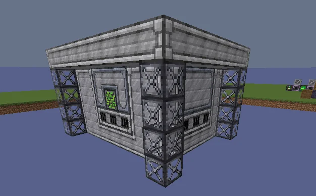
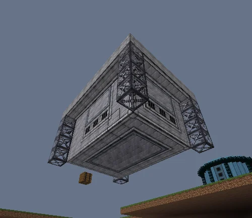
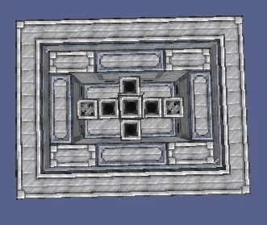

# Stellar Nucleosynthesis Astrochemistry Disassembler (S.N.A.D)
<small>**Submitted by:** rinbow (@rinbow_) · Multiblock Design Contest, September 2026</small>

!!! quote ""

| | |
|---|---|
| **Target tier** | <LuV>LuV</LuV>/<ZPM>ZPM</ZPM> |
| **Role** | Processing — targeted noble gas production from Nether Star shards |
| **Schematic** | [snad.nbt](Contest_img/stellar-nucleosynthesis-astrochemistry-disassembler/snad.nbt) |
| **Original post** | [Stellar Nucleosynthesis Astrochemistry Disassembler (S.N.A.D)](https://discord.com/channels/1177211394039484477/1554640789798125598) |

## Summary

A late-game processing multiblock that turns the different Nether Star shards (Earth, Ice, Lightning, Fire, and the base shard) into individual rare gases. Each recipe takes one infused shard, Refinery Gas, and a matching dust, and produces only the one gas asked for. The author pitches it as a more precise and faster way of getting a single noble gas, without the byproducts of Liquid Air distillation.

## Mechanics

- Each recipe consumes one shard, 16,000 mB of Refinery Gas (chosen for its helium content), and a dust, and outputs a single rare gas. The author describes these as base ideas that are not confirmed to be balanced and asked for feedback on them:

| Gas | Shard | Refinery Gas | Dust | Output | Duration | Tier |
|---|---|---|---|---|---|---|
| Argon | 1 Earth Infused Shard | 16,000 mB | 64 Potassium Dust | 1,000 mB | 10 s | <LuV>LuV</LuV> |
| Neon | 1 Fire Infused Shard | 16,000 mB | 64 Magnesium Dust | 1,000 mB | 15 s | <LuV>LuV</LuV> |
| Krypton | 1 Lightning Infused Shard | 16,000 mB | 32 Caesium Fluoride Dust | 2,000 mB | 20 s | <LuV>LuV</LuV> |
| Xenon | 1 Ice Infused Shard | 16,000 mB | 64 Crushed Ice | 2,000 mB | 20 s | <LuV>LuV</LuV> |
| Radon | 1 Nether Star Shard | 16,000 mB | 16 Uranium 238 Dust | 2,500 mB | 50 s | <ZPM>ZPM</ZPM> |

- The recipes are loosely based on how these gases are produced in reality, other than from Liquid Air.
- Supports tier overclocking and parallel processing. The author is unsure what else the machine should need or have.
- The author notes that, unlike the Exotic Gas Siphon (EGS), which costs nothing to run, this machine consumes materials for its gases, so it is not meant to replace the EGS.
- After thread feedback, the author said they liked the idea of the shard being consumed only by chance (suggesting something like 50%) together with higher outputs, but did not post revised recipes.

## Structure

A boxy casing-and-frame structure with a cross-shaped block arrangement in its interior; the ME Controller in the screenshots is a placeholder for the machine block. The author did not state the dimensions.

!!! abstract "Screenshots"

    === "Front"
        

    === "Bottom"
        

    === "Top view"
        

    === "Recipe inputs"
        

## Files

- [snad.nbt](Contest_img/stellar-nucleosynthesis-astrochemistry-disassembler/snad.nbt) — structure NBT schematic

## Notes from the thread

- Several replies considered the proposed recipes far too weak for <LuV>LuV</LuV>/<ZPM>ZPM</ZPM>; one suggested at least 15x the outputs, another said they would only consider using it at 8 or 16 buckets of gas per recipe, and the Refinery Gas input was called a little strange but workable.
- Multiple people objected to spending Nether Stars on noble gases at all: the shard loop is meant to grow star production, star shortages are common, and the gases are already easy to get from Liquid Air distillation. Suggested fixes were a chance-based shard consumption, better output quantities, and possibly more useful gases.
- One reply pointed out that because Nether Star demand varies so much over the pack, the real cost of the machine would be highly variable regardless of how the recipes are balanced.
