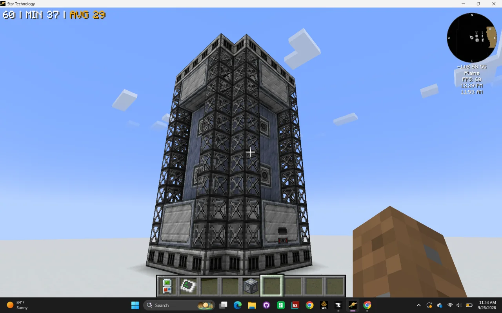
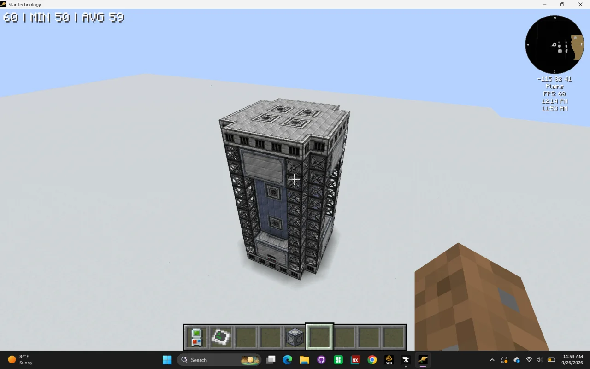
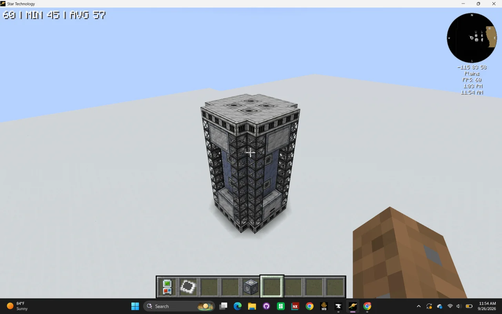
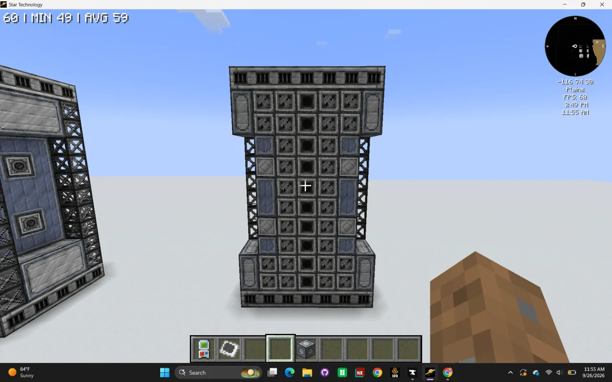

# Synergistic Gas Turbine (SGT)
<small>**Submitted by:** Serotonintheft (@serotonintheft) · Multiblock Design Contest, September 2026</small>

!!! quote ""

| | |
|---|---|
| **Target tier** | <LuV>LuV</LuV> |
| **Role** | Power generation — multi-fuel gas turbine with a variety bonus |
| **Schematic** | [sgt.nbt](Contest_img/synergistic-gas-turbine/sgt.nbt) |
| **Original post** | [Synergistic Gas Turbine](https://discord.com/channels/1177211394039484477/1553489777012244650) |

## Summary

A gas turbine that gets a boost when it burns several fuels at the same time. It produces large amounts of power, with the tradeoff that the player has to set up production for a wider variety of fuels instead of a single one.

## Mechanics

- Burns up to **5 different combustible gases** at once, using the same fuel list as the Large Gas Turbine (LGT).
- Any gas fed into the SGT is consumed at the rate of **3 LGTs** burning that gas, with all rotor holder and rotor calculations applied as normal.
- Power output equals the LGT output of all input gases combined, multiplied by a **variety multiplier**:
    - 1 gas: multiplier 1.
    - Each additional gas type being burned at the same time adds 0.5.
    - Maximum multiplier 3, reached when 5 different gases are burned at once.
- Example from the author: fed Nitrobenzene (nbz), Propane, Ethylene, Coal Gas, and Naphtha all at once, the SGT consumes the equivalent of 3 LGTs of each gas and produces the amps of 9 LGTs of each gas, or 45 LGTs in total (LGT output does not depend on which gas is used).
- All **8 rotor holders** must be the same tier and hold the same rotor for the SGT to work.
- Accepts any number of dynamo or laser hatches, and 64A substation dynamos if the competition rules allow them.
- All hatches and buses must be placed on Pallaridium Turbine Casings.

## Structure

A tall, narrow tower with a wider base and crown, built from Pallaridium Turbine Casings and open frames, with 8 rotor holders; the author did not state the dimensions. The author notes the screenshots were taken with the rotor holders not yet formed.

!!! abstract "Screenshots"

    === "Front"
        

    === "Angled view"
        

    === "Opposite corner"
        

    === "Cross-section"
        

## Files

- [sgt.nbt](Contest_img/synergistic-gas-turbine/sgt.nbt) — NBT structure file

## Notes from the thread

- A commenter asked why the entry allowed only substation dynamos and no laser hatches (for parity with the MCF); the author had assumed a laser power spine would not fit at <LuV>LuV</LuV>, agreed it was a fair point, and edited the post so the SGT accepts dynamo and laser hatches.
