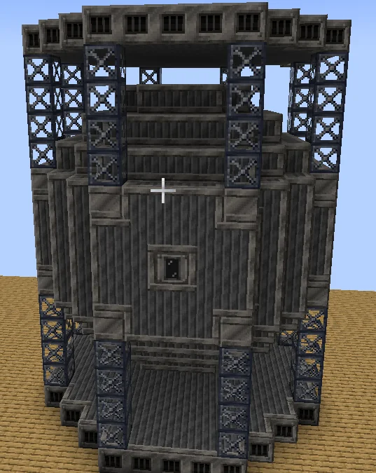

# Syngas Processing Facility (SPF)
<small>**Submitted by:** Uncraftable204 (@uncraftable204) · Multiblock Design Contest, September 2026</small>

!!! quote ""

| | |
|---|---|
| **Target tier** | <LV>LV</LV> |
| **Role** | Processing — steam and coal to syngas and carbon products |
| **Schematic** | Not provided as a file (the author linked a [Google Doc](https://docs.google.com/document/d/1dw64q708RNb6qBmm9ttagWqvrvnY8xjiog_XvlZ0-hs/edit?usp=sharing) containing a block-state dump of the structure) |
| **Original post** | [SPF](https://discord.com/channels/1177211394039484477/1553964470496268299) |

!!! warning "Incomplete submission"

    The post gives only a one-line functional summary. There is no in-depth mechanics section, no schematic file (only an external Google Doc link), and a single screenshot.

## Summary

A multiblock that converts Steam and Coal or Charcoal blocks into Syngas, then processes that Syngas further into carbon products.

## Mechanics

- Input: Steam plus Coal blocks or Charcoal blocks.
- Intermediate: Syngas.
- Output: carbon products (not further specified by the author).
- Submitted at <LV>LV</LV>; in the thread the author said it is probably meant more as an <HV>HV</HV>-tier machine but kept the steel casings because they preferred the look over the <MV>MV</MV> or <HV>HV</HV> casings.

## Structure

A large, tiered steel structure: the block-state dump lists Steel Firebox Casings, Steel Frames, Steel Machine Casings, Solid Machine Casings, and an LV Input Bus, with a stepped core wrapped in steel frame columns. The author did not state the dimensions.

!!! abstract "Screenshots"

    === "Front"
        

## Notes from the thread

- Feedback called the steel cost "crazy" for an <LV>LV</LV>, pre-AE2 build and suggested bronze instead; the author replied that the machine is probably more of an <HV>HV</HV>-tier design but that they prefer the steel casing to the <MV>MV</MV> or <HV>HV</HV> ones.
