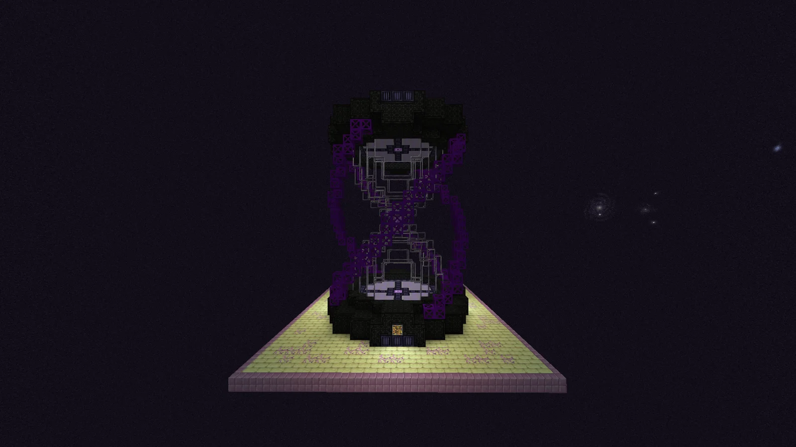
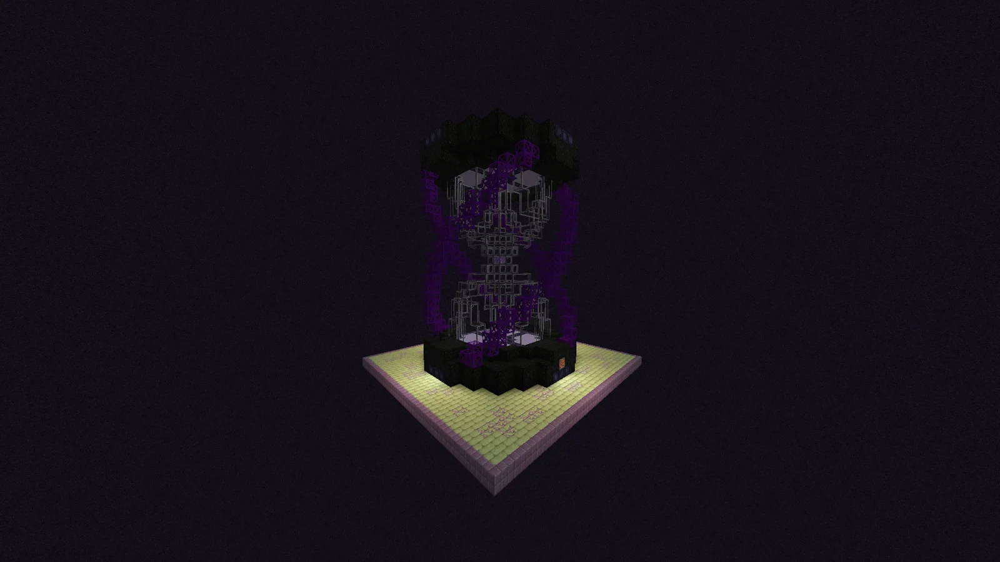
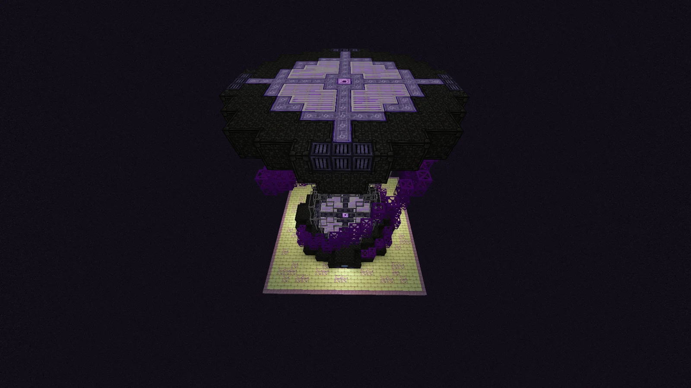
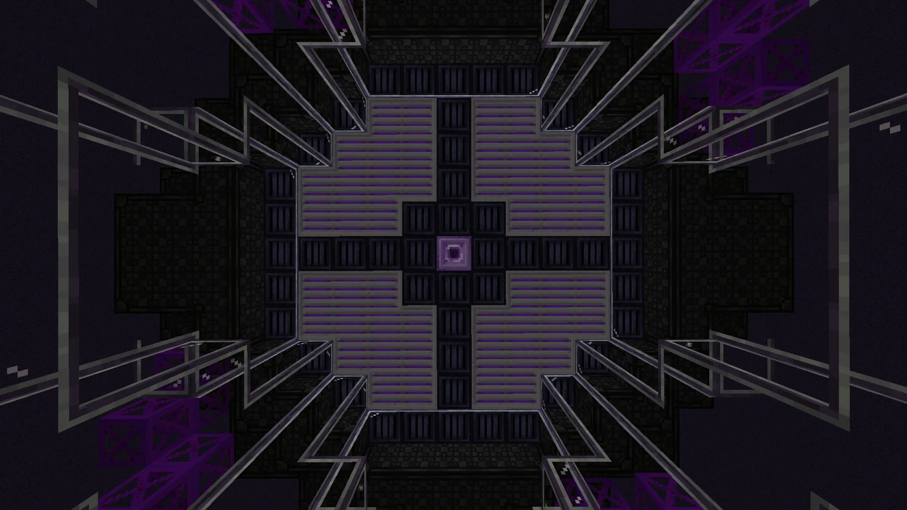

# Temporally Insurgent Monocrystal Energizer (TIME)
<small>**Submitted by:** Skylaar (@skylaar.) · Multiblock Design Contest, September 2026</small>

!!! quote ""

| | |
|---|---|
| **Target tier** | <UIV>UIV</UIV>+ (Post-K.O.M.A.R.U.) |
| **Role** | Processing — temporally accelerated crystal growth |
| **Schematic** | [time.nbt](Contest_img/temporally-insurgent-monocrystal-energizer/time.nbt) |
| **Original post** | [Temporally Insurgent Monocrystal Energizer [TIME]](https://discord.com/channels/1177211394039484477/1555249342837686353) |

## Summary

TIME is a late-game multiblock that grows advanced crystals which, under normal circumstances, would take thousands or millions of years to form. Recipes do not progress in real time; instead the player feeds measured amounts of special **Temporal Accelerants** into the machine to advance the recipe, while managing the **Temporal Instability** this causes. Hitting a recipe-specific instability window at the end of a recipe doubles the output.

The author places it at <UIV>UIV</UIV>+, after K.O.M.A.R.U., and notes that it can easily be moved to <UXV>UXV</UXV> if it does not fit thematically with the abyssal/riftic content.

## Mechanics

**Recipes**

- TIME recipes are advanced autoclave recipes: an impure catalyst dust plus a supersaturated solution (in the form of liquid hellforge alloys) grow into a pure crystal.
- Recipe progress is measured in units of **Years** (functionally similar to CWU) rather than ticks. Overclocks halve the Years required.

**Temporal Lock**

- Once a recipe begins, TIME enters a Temporal Lock, a temporal vacuum separate from the outside world. In this state the only accepted inputs are Temporal Accelerants and Faematter.
- Every 10 seconds the machine checks its inputs and consumes everything provided. If any other input is present, or if Temporal Accelerant and Faematter are provided at the same time, the recipe fails.
- Providing Temporal Accelerant adds recipe progress in Years, scaled by the amount consumed and the accelerant's tier, but also raises Temporal Instability by the same factors.
- Temporal Instability ranges from 0% to 100%; if it ever exceeds 100%, the recipe fails. Providing Faematter in increments of 10 B lowers instability without adding progress.

**Formulas**

```
Years = ( 4 ^ ( [Temporal Accelerant Tier] - 1 ) ) * [mB Temporal Accelerant]
Temporal Instability Increase = ( 10 ^ ( [mB Temporal Accelerant] / 1000 ) ) * ( 2 ^ ( [Temporal Accelerant Tier] - 1 ) )
Temporal Instability Decrease = ( 1 - ( 0.5 ^ [10B Faematter] ) ) * [Current Temporal Instability]
```

**Temporal Sync**

- Every recipe has a Temporal Sync range. If the machine's Temporal Instability is within that range when the recipe ends, the output is doubled.
- After every recipe the Temporal Lock is removed and Temporal Instability resets to 0%.

**New items and fluids**

- **Impure Catalysts** — crafted in Mixers / Injection Mixers. They would replace the current dust outputs in applicable recipes (for example, the Aquariadic-Rimuli-Dragonix Dust recipe would instead yield Impure Aquariadic-Rimuli-Dragonix Catalyst).
- **Temporal Accelerants** — three tiers. The first, Crude Chronometric Serum, is made through a complex pre-DSG processing line, ideally using Riftic fluids. The other two are post-DSG and crafted from products of black hole processing/harvesting (whatever that ends up being).

**Redstone Variadic Interfacing**

TIME accepts Redstone Variadic Interfaces with two interfacing options:

- *Temporal Instability %* — outputs a redstone signal based on how close the Temporal Instability is to a target value.
- *Recipe Progress %* — outputs a redstone signal based on how close the recipe is to completion.

**Other machine notes**

- Accepts 1-2 energy hatches and up to 5 total input hatches.
- The Amethyst Block in the center of the machine is a placeholder and should be replaced by an Omnipresent Budding Amethyst block, crafted in a Draconic Infusion Array at <UXV>UXV</UXV> voltage (permission granted).
- The TIME controller is crafted in a Riftic Assembly Unit at <UIV>UIV</UIV> voltage, using a Large Crystallization Chamber controller scan in a Component Data Core as research, at <UXV>UXV</UXV> voltage.

## Structure

A 17x23x17 hourglass-shaped tower (oversize permission granted): two dark casing caps joined by a waist of purple glass and pipe-like framing, with a wide cross-patterned top deck and a central placeholder Amethyst Block.

!!! abstract "Screenshots"

    === "Front"
        

    === "Angled"
        

    === "Top"
        

    === "Interior cap"
        

## Files

- [time.nbt](Contest_img/temporally-insurgent-monocrystal-energizer/time.nbt) — structure block (NBT) schematic
