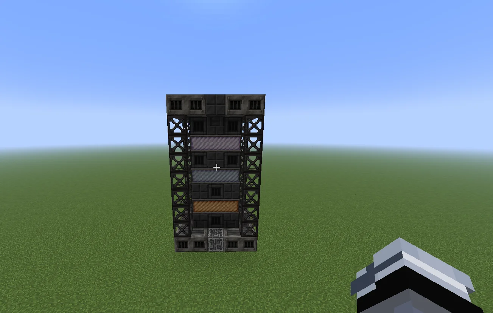
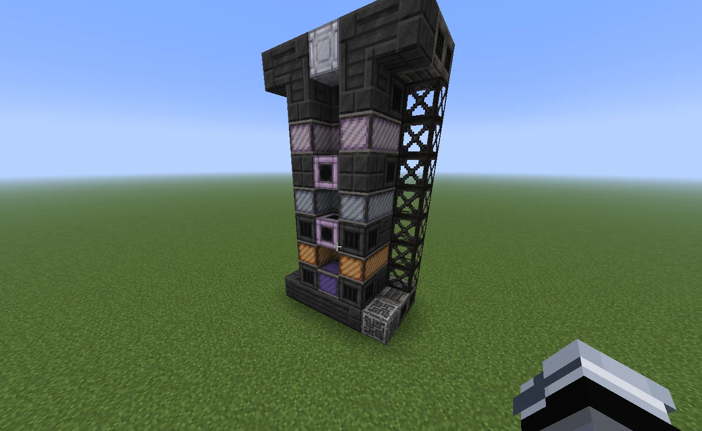
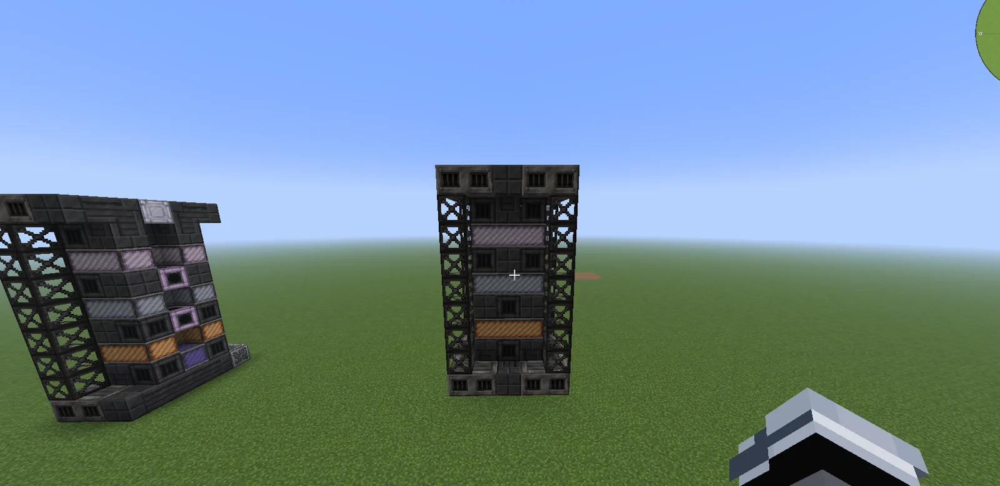
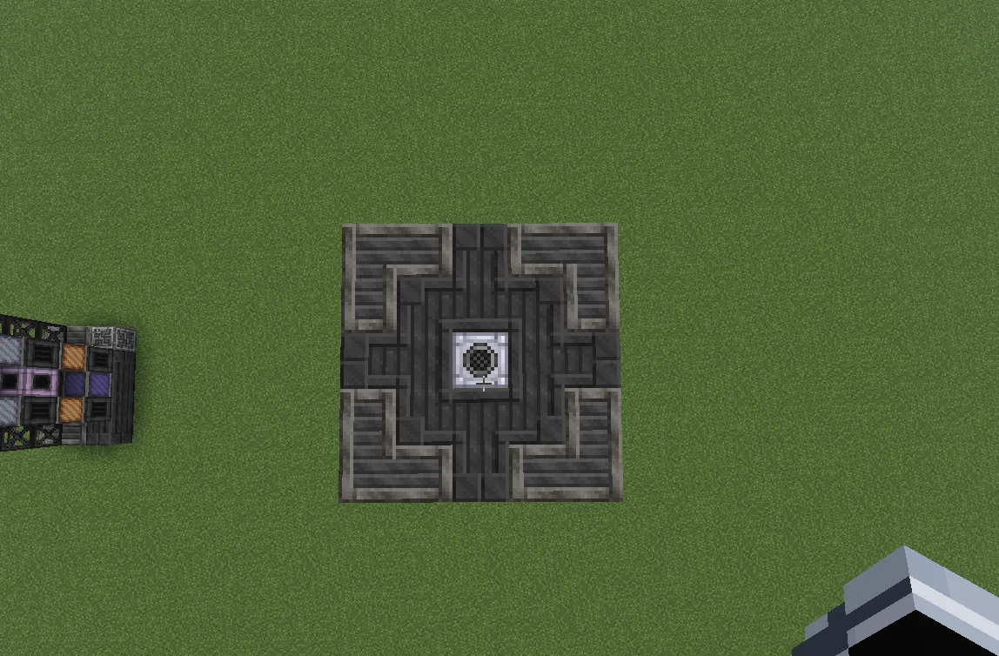
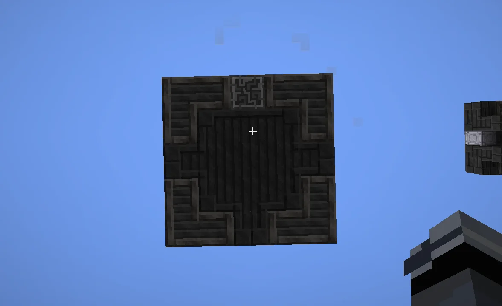

# Thermal Cascade Furnace (TCF)
<small>**Submitted by:** Magda (@sebo5959) · Multiblock Design Contest, September 2026</small>

!!! quote ""

| | |
|---|---|
| **Target tier** | <EV>EV</EV> |
| **Role** | Processing — stacked Smelter, Alloy Smelter and Arc Furnace |
| **Schematic** | [tcf.nbt](Contest_img/thermal-cascade-furnace/tcf.nbt) |
| **Original post** | [Thermal Cascade Furnace (TCF)](https://discord.com/channels/1177211394039484477/1553407894945275986) |

## Summary

A single tall multiblock that combines a Smelter, an Alloy Smelter and an Arc Furnace. The three functions are stacked vertically, each with its own band of coils, and the whole structure is fed through hatches placed between the coil bands.

## Mechanics

- Three processing sections stacked from top to bottom: smelting at the top, alloy smelting in the middle and the arc furnace at the bottom.
- Three bands of coils. The middle coils must be one tier lower than the top coils, and the bottom coils must be one tier lower than the middle coils.
- Parallel capability is based on the bottom coils.
- Input placement follows the sections: smelter input hatches go between the top of the structure and the top coils, Alloy Smelter input busses go between the top and middle coils, and Arc Furnace inputs go between the middle and bottom coils.
- Outputs are not fixed yet; the author would put them either below the coils of the corresponding section or at the bottom of the multiblock.

## Structure

A tall, narrow tower of dark casings with frame columns on the corners, three coil bands separated by casing layers, and the controller in the bottom row. The author did not state the dimensions.

!!! abstract "Screenshots"

    === "Front"
        

    === "Cutaway"
        

    === "Front and cutaway"
        

    === "Top"
        

    === "Bottom"
        

## Files

- [tcf.nbt](Contest_img/thermal-cascade-furnace/tcf.nbt) — Create Schematicannon schematic (added by the author shortly after the post)

## Notes from the thread

- Two readers pointed out that comparable multiblocks already exist in the pack (the Multi Smelter and the Limitless Smelter); the author did not respond.
