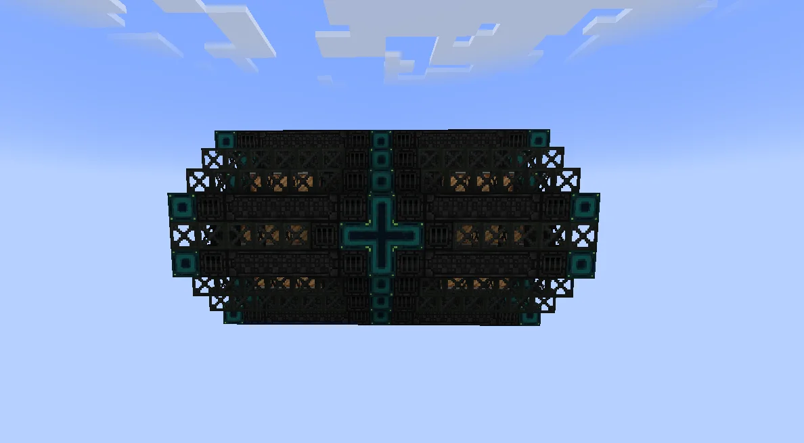
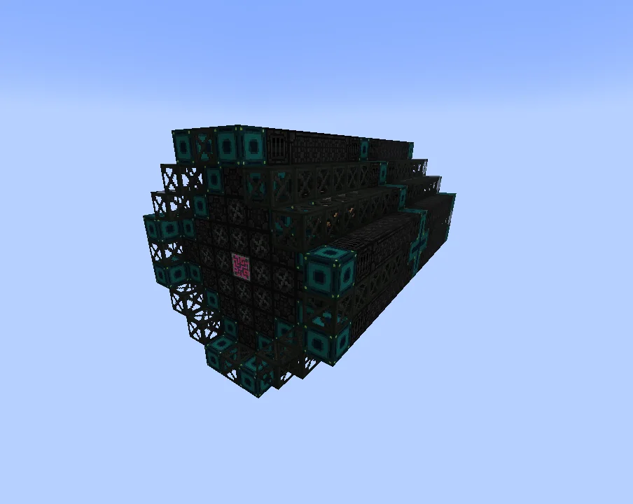
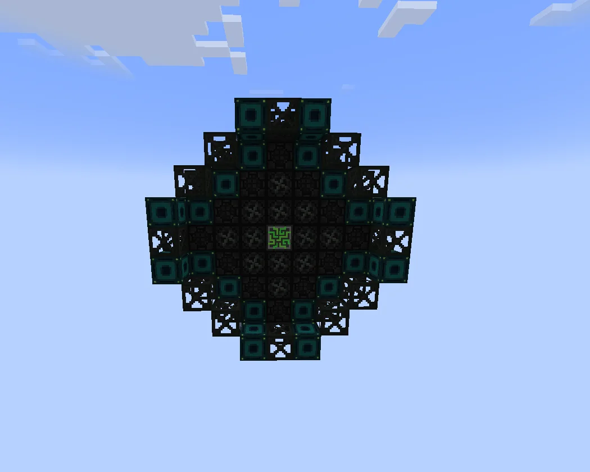
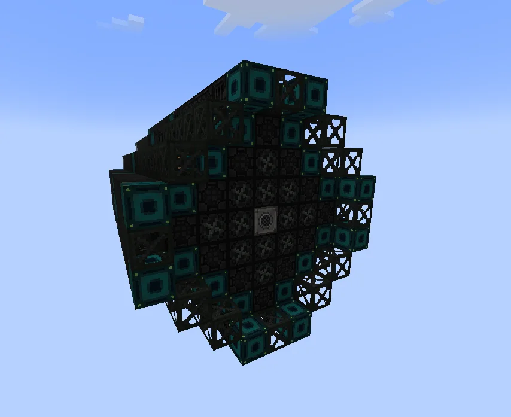

# Thermal Dissociation Complex (TDC)
<small>**Submitted by:** venus (@d2j7) · Multiblock Design Contest, September 2026</small>

!!! quote ""

| | |
|---|---|
| **Target tier** | <ZPM>ZPM</ZPM> and above |
| **Role** | Processing — parallel Pyrolyse Oven |
| **Schematic** | [tdc.nbt](Contest_img/thermal-dissociation-complex/tdc.nbt) |
| **Original post** | [Thermal Dissociation Complex [TDC]](https://discord.com/channels/1177211394039484477/1555249097001279489) |

## Summary

A Pyrolyse Oven multiblock with parallel hatches, intended for <ZPM>ZPM</ZPM> and later. The author points out that most other processing multiblocks already have a parallel alternative while the Pyrolyse Oven does not, so ZPM+ setups need very large numbers of TDAs and this gets exponentially worse from there. The TDC is meant to cover the ZPM+ mass processing that the TDA does not scale into.

## Mechanics

- Functionally a Pyrolyse Oven with parallel hatches; no new recipes are described.
- The author gives no parallel count or other numbers.

## Structure

A long, dark structure of machine casings and frame blocks with teal-bordered casings, visually modeled on the TDA for consistency. The author did not state the dimensions. Placement rules from the author: busses and hatches may only replace machine casings, and the muffler hatch must be in the middle of the back side.

!!! abstract "Screenshots"

    === "Side"
        

    === "Front, angled"
        

    === "Front"
        

    === "Back, angled"
        

## Files

- [tdc.nbt](Contest_img/thermal-dissociation-complex/tdc.nbt) — Create schematic (.nbt)

## Notes from the thread

- Thread feedback asked whether the NBZ line is still used at <ZPM>ZPM</ZPM>+, noting that oil processing is replaced by bacteria at <UV>UV</UV>. The author answered that having a parallel-hatch alternative for every machine in the NBZ line except the Pyrolyse Oven feels out of place and heavily bottlenecks the line, and said they have no experience with the bacteria stage yet.
