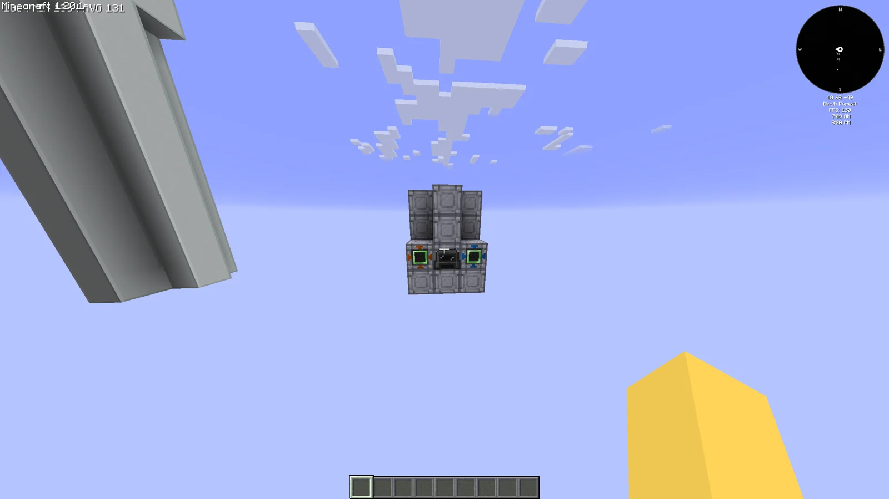
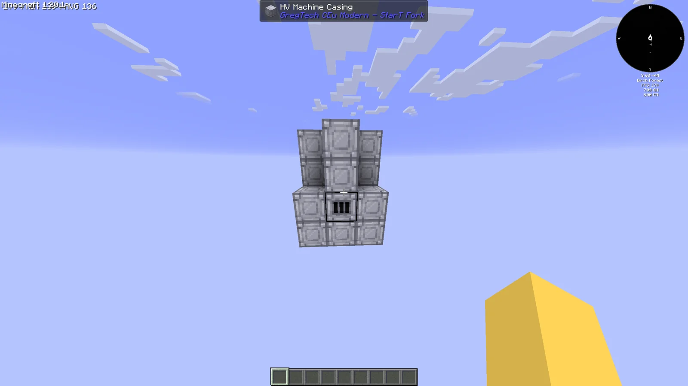
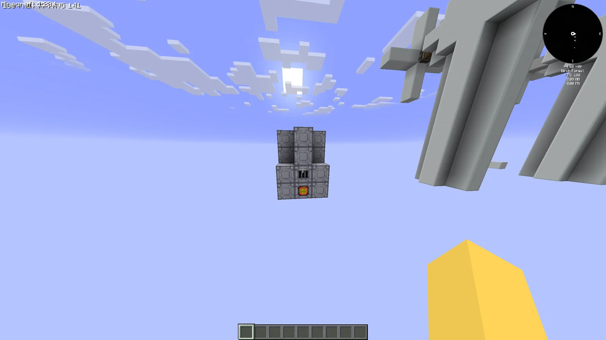
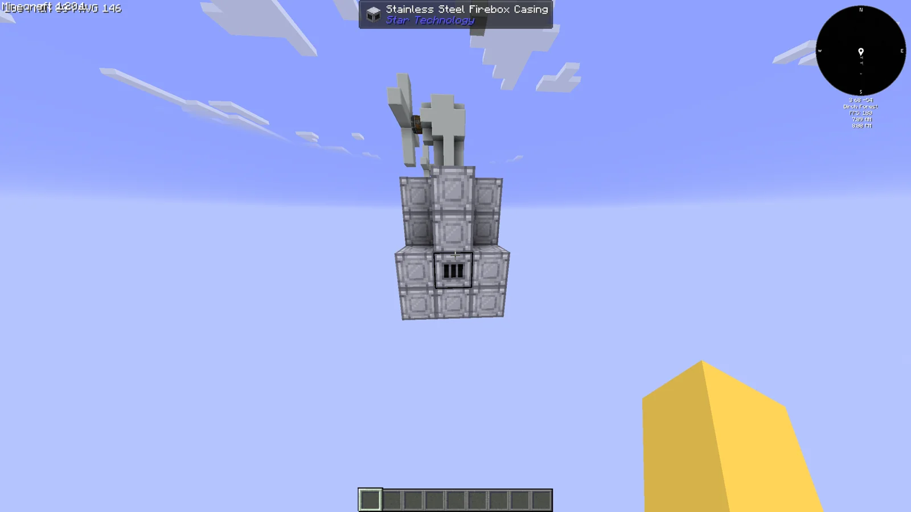
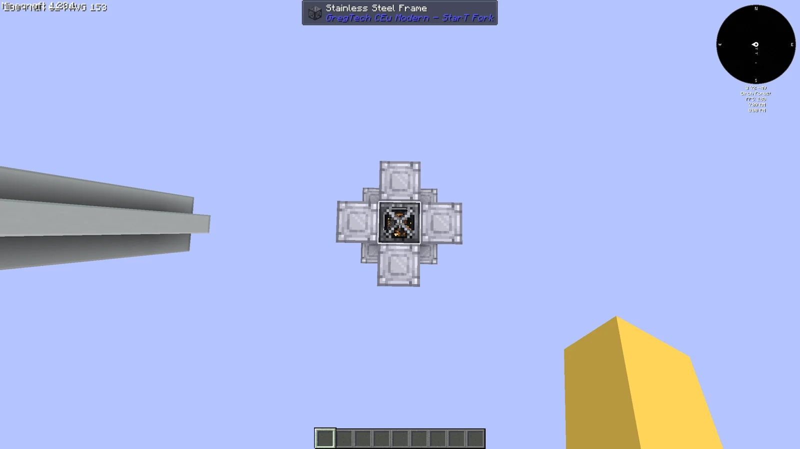
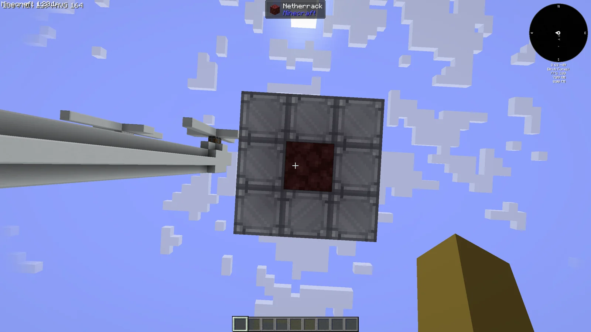

# Thermal Plant
<small>**Submitted by:** enlolers (@enlolers) · Multiblock Design Contest, September 2026</small>

!!! quote ""

| | |
|---|---|
| **Target tier** | <HV>HV</HV> |
| **Role** | Power generation — fuel and Water to EU via steam |
| **Schematic** | [thermal-plant.json](Contest_img/thermal-plant/thermal-plant.json) |
| **Original post** | [Thermal Plant](https://discord.com/channels/1177211394039484477/1552742408783925419) |

## Summary

An <HV>HV</HV> power generator that consumes fuel and Water to produce power.

## Mechanics

- Accepts any fuel together with Water.
- Boils the Water into steam and converts that steam into power inside the same structure, with no separate turbine step.
- The author gave no further numbers (fuel rates, steam or EU output).

## Structure

A small 3x3 footprint, four blocks tall, built mostly from HV Machine Casings with Stainless Steel Firebox Casings in the lower section, a Netherrack block with fire underneath, and two Stainless Steel Frames forming a short stack on top. The controller position on the front face is occupied by an HV Arc Furnace in the mockup, flanked by an HV Input Hatch and an HV Energy Output Hatch, with an HV Input Bus elsewhere in the wall (block list taken from the schematic).

!!! abstract "Screenshots"

    === "Front"
        

    === "Side"
        

    === "Back"
        

    === "Side (firebox)"
        

    === "Top"
        

    === "Bottom"
        

## Files

- [thermal-plant.json](Contest_img/thermal-plant/thermal-plant.json) — JSON block-state schematic with the required block list (3x4x3)
