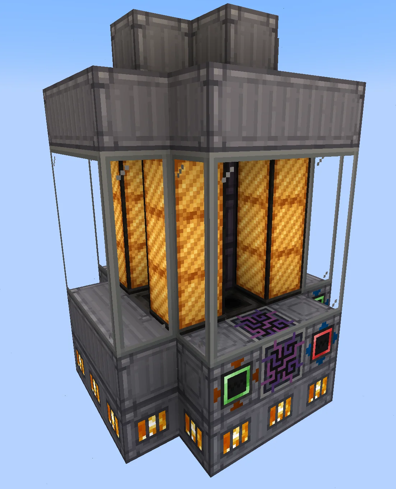
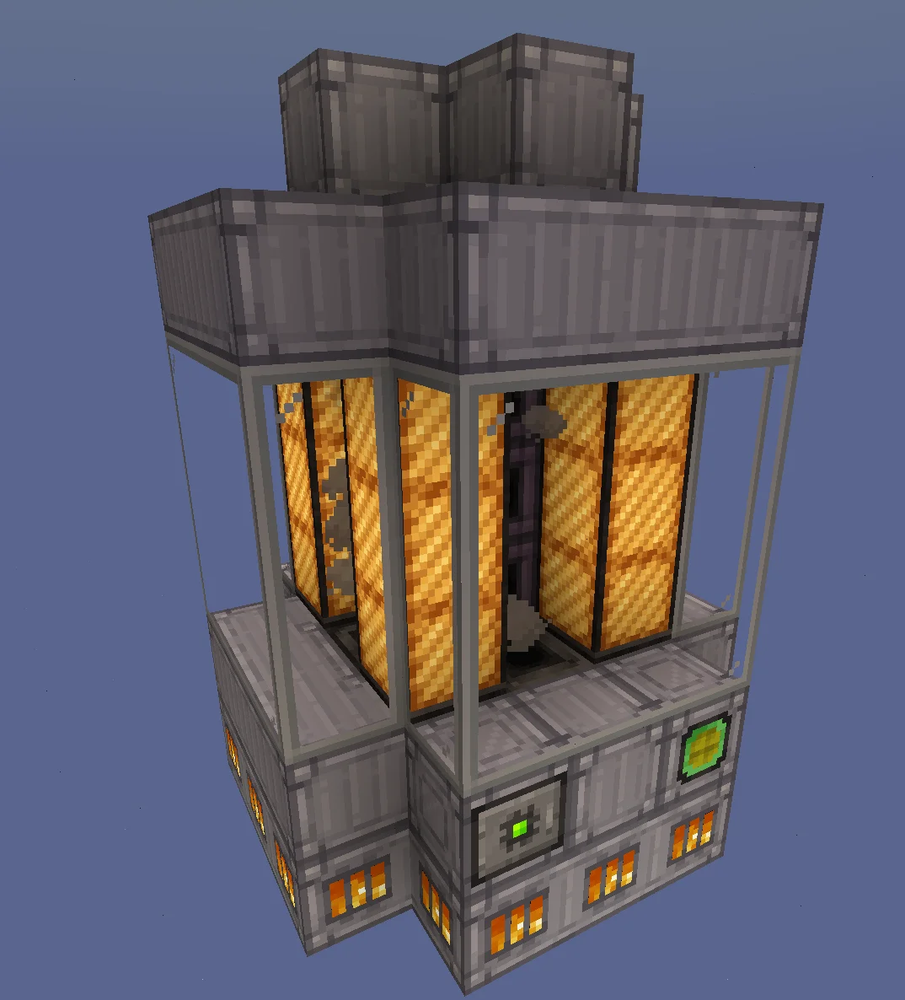
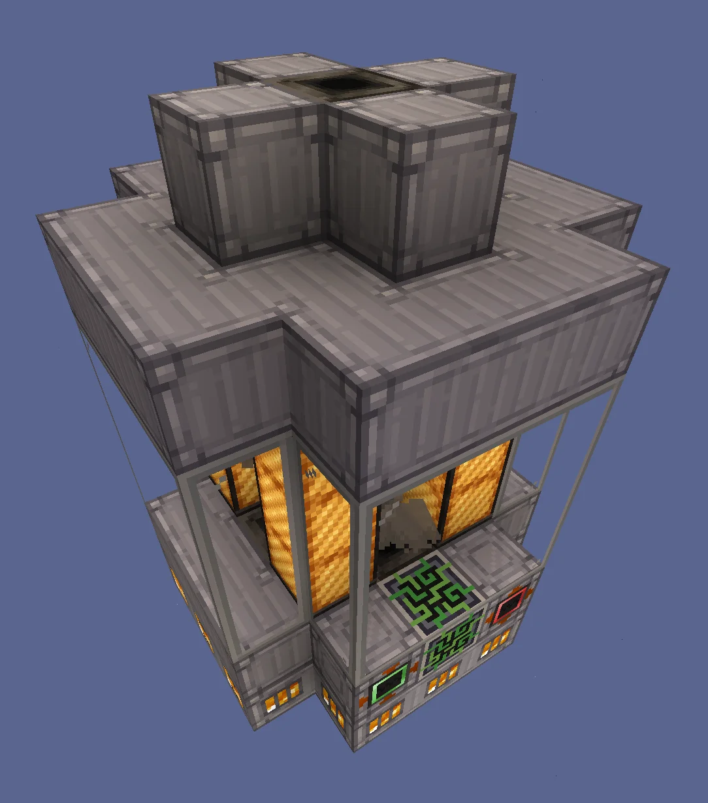
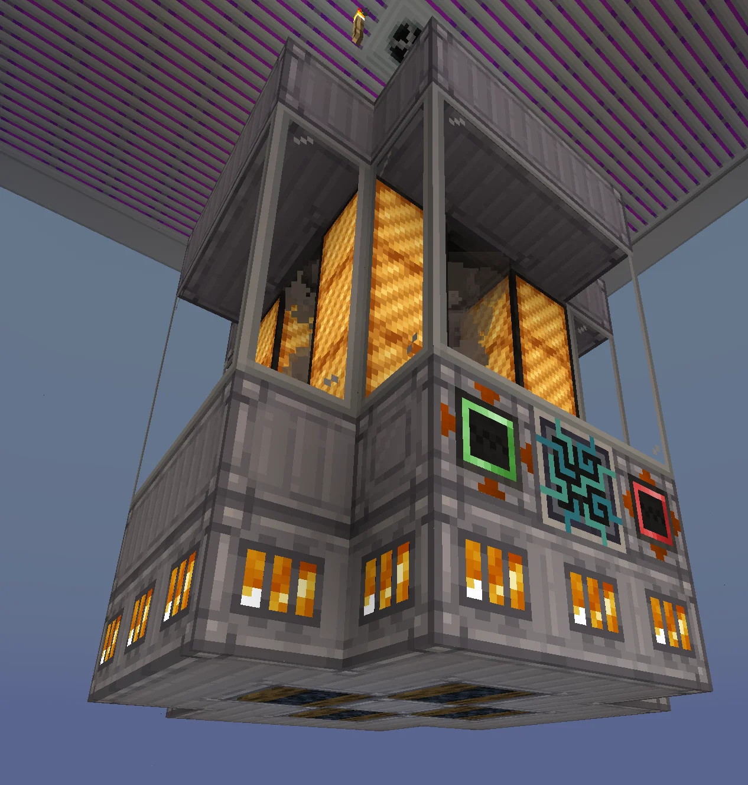
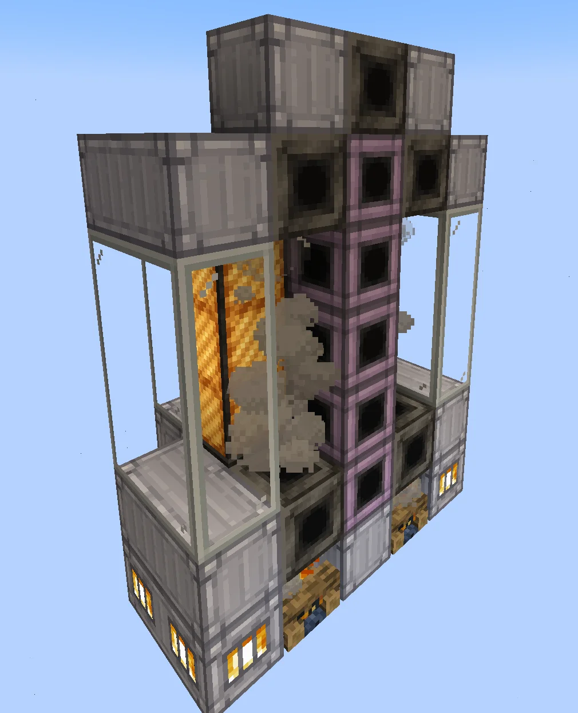
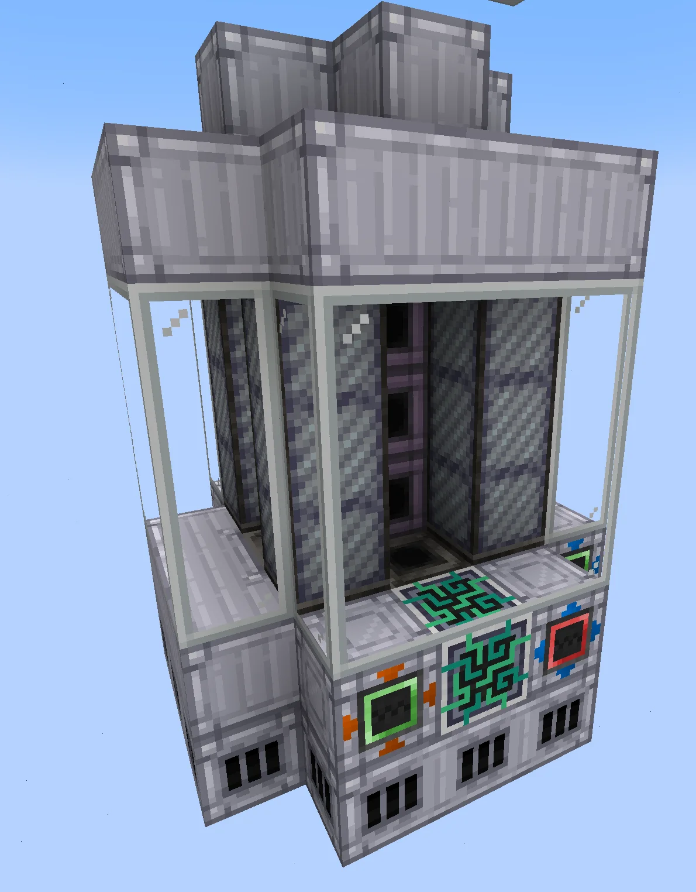

# Thermic Fluid Heater (TFH)
<small>**Submitted by:** Kiiyoko (@kiiyoko) · Multiblock Design Contest, September 2026</small>

!!! quote ""

| | |
|---|---|
| **Target tier** | late <HV>HV</HV> (requires Titanium Pipe Casing) |
| **Role** | Processing — multiblock Fluid Heater usable inside a cleanroom |
| **Schematic** | Copy-paste string in the post (see Files) |
| **Original post** | [Thermic Fluid Heater [TFH]](https://discord.com/channels/1177211394039484477/1552813507031076874) |

## Summary

A late-<HV>HV</HV> multiblock version of the Fluid Heater (described by the author as a "TPB fluid heater"). In Theta 2 every single-block machine in the Sterilized Growth Medium chain can already be replaced by a multiblock except the Fluid Heater, because the existing multiblock needs a muffler hatch. The Thermic Fluid Heater has no muffler, so it can be built inside a cleanroom and closes that gap.

## Mechanics

- Multiblock Fluid Heater with no muffler hatch, so it is usable in a cleanroom.
- Takes a 16A energy hatch. Because of that, the author suggests the Sterilized Growth Medium recipe should get a much longer recipe time to incentivize actually using this machine.
- The coils should not be replaceable or upgradeable; the author feels coil upgrades would not make sense here. The schematic uses Kanthal Coil Blocks.
- The original design used campfires in the base to emulate steam with their smoke. After thread feedback, the author replaced them with plain Stainless Steel Casing (the schematic in the post was updated to match).

## Structure

A tall, narrow tower: a base of Stainless Steel Firebox Casing and Clean Machine Casing, a Cleanroom Glass column showing Kanthal coils around a central Titanium Pipe Casing core, and a stepped Clean Machine Casing roof. The pasted schematic spans 5×7×5 blocks and lists 35 Clean Machine Casing, 36 Cleanroom Glass, 16 Stainless Steel Firebox Casing, 12 Kanthal Coil Block, 8 Steel Pipe Casing, 5 Titanium Pipe Casing, 1 Stainless Steel Frame, plus an HV energy input hatch, HV input hatch, HV input bus, HV output hatch and an auto maintenance hatch. The ME controller block in the schematic and screenshots only marks where the multiblock controller would go.

!!! abstract "Screenshots"

    === "Front"
        

    === "Side"
        

    === "Top"
        

    === "Bottom"
        

    === "Cross section"
        

    === "Interior, inactive"
        

The cross section still shows the earlier campfire base; the updated version replaces those campfires with Stainless Steel Casing.

## Files

No schematic file was attached. The author pasted the structure as a copy-paste string in the post body (updated after the campfire change and after fixing the hatches to HV input/output hatches instead of a single output bus):

??? note "Copy-paste string"

    ```json
    {"name":"TFH","statePosArrayList":"{blockstatemap:[{Name:\"minecraft:air\"},{Name:\"kubejs:stainless_steel_firebox_casing\",Properties:{active:\"true\"}},{Name:\"gtceu:hv_energy_input_hatch\",Properties:{facing:\"north\"}},{Name:\"gtceu:clean_machine_casing\"},{Name:\"gtceu:auto_maintenance_hatch\",Properties:{facing:\"north\"}},{Name:\"gtceu:cleanroom_glass\"},{Name:\"gtceu:steel_pipe_casing\"},{Name:\"gtceu:kanthal_coil_block\",Properties:{active:\"true\"}},{Name:\"gtceu:titanium_pipe_casing\"},{Name:\"gtceu:stainless_steel_frame\"},{Name:\"gtceu:hv_input_hatch\",Properties:{facing:\"south\"}},{Name:\"gtceu:hv_input_bus\",Properties:{facing:\"south\"}},{Name:\"chisel_chipped_integration:futura_me_controller_ae_2\",Properties:{blockstate:\"0\"}},{Name:\"gtceu:hv_output_hatch\",Properties:{facing:\"south\"}}],endpos:{X:4,Y:6,Z:0},startpos:{X:0,Y:0,Z:-4},statelist:[I;0,1,1,1,0,0,2,3,4,0,0,5,5,5,0,0,5,5,5,0,0,5,5,5,0,0,3,3,3,0,0,0,0,0,0,1,1,3,1,1,3,3,6,3,3,5,7,0,7,5,5,7,0,7,5,5,7,0,7,5,3,3,6,3,3,0,0,3,0,0,1,3,3,3,1,3,6,8,6,3,5,0,8,0,5,5,0,8,0,5,5,0,8,0,5,3,6,8,6,3,0,3,9,3,0,1,1,3,1,1,3,3,6,3,10,5,7,0,7,5,5,7,0,7,5,5,7,0,7,5,3,3,6,3,3,0,0,3,0,0,0,1,1,1,0,0,11,12,13,0,0,5,5,5,0,0,5,5,5,0,0,5,5,5,0,0,3,3,3,0,0,0,0,0,0]}","requiredItems":{"gtceu:hv_energy_input_hatch":1,"kubejs:stainless_steel_firebox_casing":16,"gtceu:hv_input_bus":1,"gtceu:hv_input_hatch":1,"gtceu:hv_output_hatch":1,"chisel_chipped_integration:futura_me_controller_ae_2":1,"gtceu:cleanroom_glass":36,"gtceu:stainless_steel_frame":1,"gtceu:kanthal_coil_block":12,"gtceu:steel_pipe_casing":8,"gtceu:titanium_pipe_casing":5,"gtceu:clean_machine_casing":35,"gtceu:auto_maintenance_hatch":1}}
    ```

## Notes from the thread

- A reviewer felt the design should follow the muffler-hatch theme of the other heating multiblocks unless the point is cleanroom use; the author confirmed cleanroom use is the point. The reviewer added that the campfires would emit particles inside a multiblock, and that a more general way to fit multiblocks into cleanrooms may be needed since this only shifts the bottleneck. The author then replaced the campfires with Stainless Steel Casing and updated the post.
- It was suggested the interior could fill with the fluid being heated (like the Mixer, Fluid Solidifier and Chemical Bath); the author liked the idea, but it was noted this would need a fairly large code addition.
- Asked why an ME controller appears in the build, the author explained it only marks the controller position.
