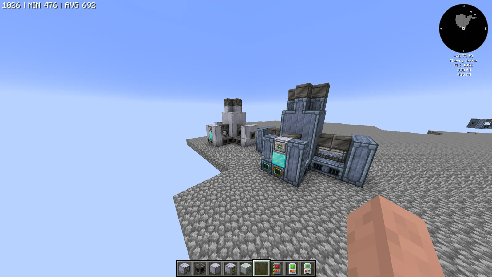
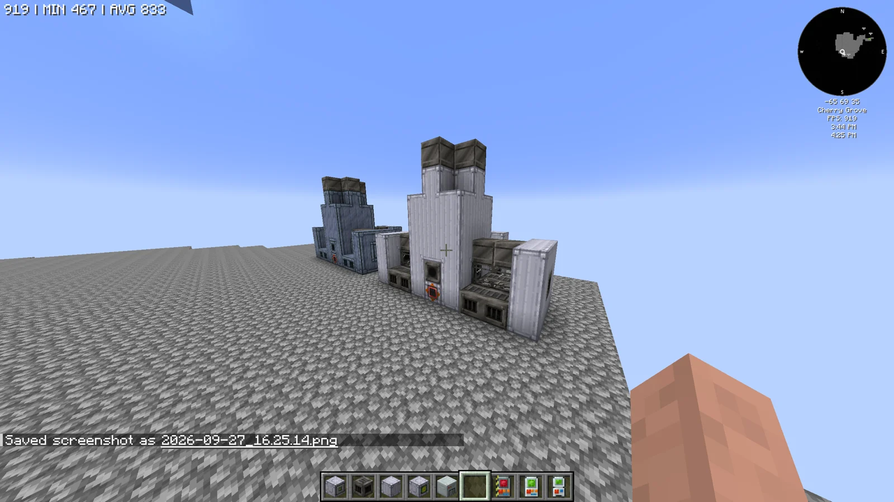
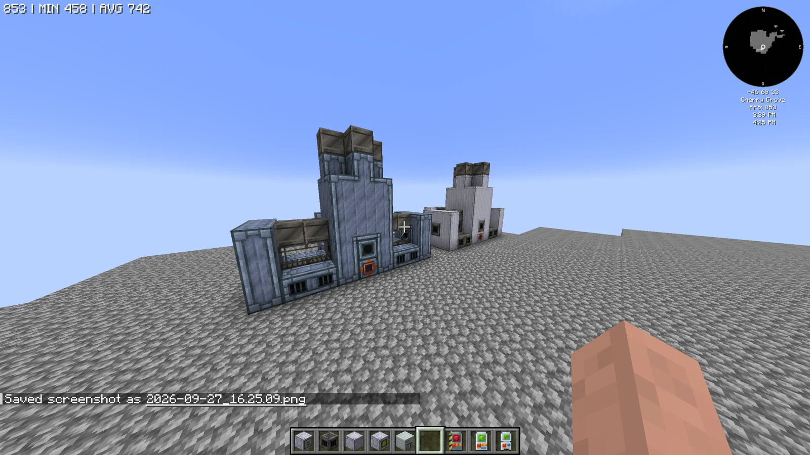
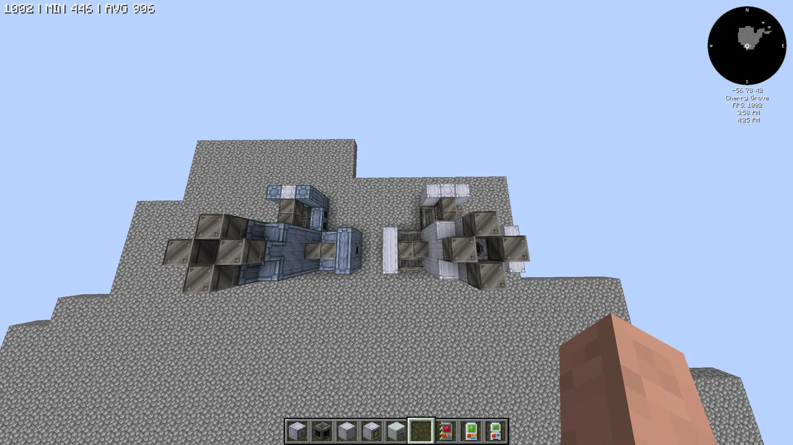

# Trace Ore Extractor (TOE) / Trace Ore Processing Plant (TOPP)
<small>**Submitted by:** novaseer (@novaseer) · Multiblock Design Contest, September 2026</small>

!!! quote ""

| | |
|---|---|
| **Target tier** | <HV>HV</HV> (regular) / <IV>IV</IV> (parallel) |
| **Role** | Multi-structure family — byproduct-focused crushed ore processing |
| **Schematic** | [toe.json](Contest_img/trace-ore-extractor-and-processing-plant/toe.json), [topp.json](Contest_img/trace-ore-extractor-and-processing-plant/topp.json) |
| **Original post** | [Trace Ore Extractor [TOE] / Trace Ore Processing Plant [TOPP]](https://discord.com/channels/1177211394039484477/1553800800789332108) |

## Summary

An alternative way of processing crushed ore that is essentially the opposite of the Pulverizer: the machine gives up most or all of the ore's primary product in exchange for a much better byproduct yield. It comes in two versions, a regular <HV>HV</HV> **Trace Ore Extractor (TOE)** and a parallel <IV>IV</IV> **Trace Ore Processing Plant (TOPP)**.

## Mechanics

- Takes crushed ore as input, like the Pulverizer, but produces significantly reduced or no primary product from it.
- In return the byproduct yield is much higher than normal; the author also raises the possibility of new byproducts.
- The author suggests the recipes might require Water, Distilled Water, or Sodium Persulfate if balance demands an additional input.
- The <HV>HV</HV> TOE is the regular version; the <IV>IV</IV> TOPP is the parallel version. The author did not state the number of parallels.
- In the submitted builds a diamond block stands in for the multiblock controller. Hatches can be placed on any stainless (TOE) or tungstensteel (TOPP) machine casing.

## Trace Ore Extractor (TOE)

### Summary

The regular <HV>HV</HV> version, built from stainless-steel (clean) machine casings with steel firebox casings, steel pipe casings, steel gearboxes, and laminated glass. The author did not state its dimensions.

### Screenshots

!!! abstract "Screenshots"

    === "TOE front"
        

### Files

- [toe.json](Contest_img/trace-ore-extractor-and-processing-plant/toe.json) — JSON block template for the Trace Ore Extractor

## Trace Ore Processing Plant (TOPP)

### Summary

The parallel <IV>IV</IV> version, built from tungstensteel (robust) machine casings with tungstensteel firebox casings, tungstensteel pipe casings, assembly line gratings, and laminated glass. The author did not state its dimensions.

### Screenshots

!!! abstract "Screenshots"

    === "TOPP front"
        

### Files

- [topp.json](Contest_img/trace-ore-extractor-and-processing-plant/topp.json) — JSON block template for the Trace Ore Processing Plant

## Structure

Both versions share the same shape: a tall central tower topped with a pair of firebox casings, a low wing on either side with gearboxes or gratings behind glass, and the controller (diamond block placeholder) in the front face of the tower. The TOE is in stainless-steel casings and the TOPP in tungstensteel casings. The author did not state the dimensions.

!!! abstract "Screenshots"

    === "Front"
        

    === "Top view"
        

## Files

- [toe.json](Contest_img/trace-ore-extractor-and-processing-plant/toe.json) — JSON block template for the Trace Ore Extractor
- [topp.json](Contest_img/trace-ore-extractor-and-processing-plant/topp.json) — JSON block template for the Trace Ore Processing Plant
