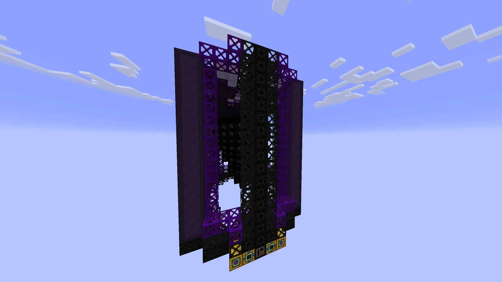
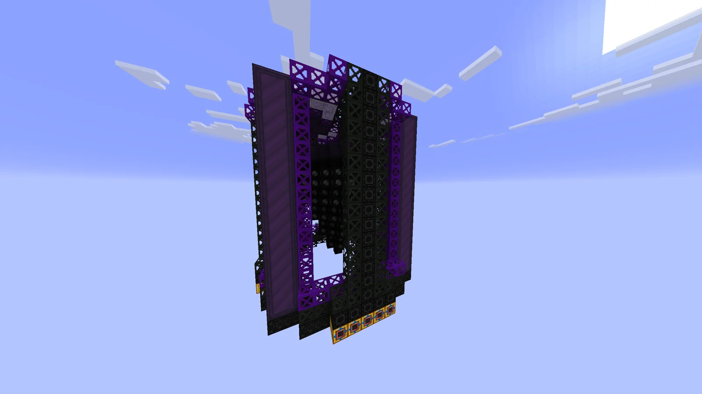
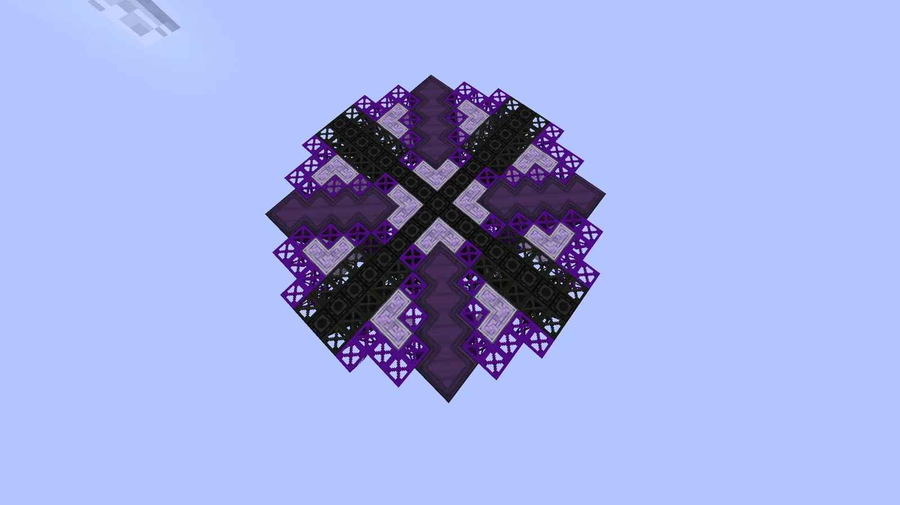
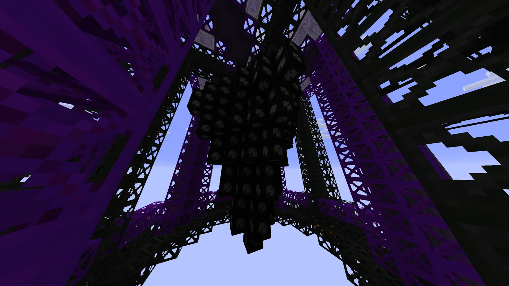
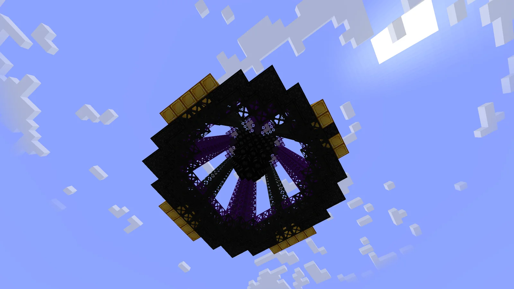

# Colossal Amazing Nano Technology Astronomical Legendary Ominous Underworld Puncturing Extractor (C.A.N.T.A.L.O.U.P.E)
<small>**Submitted by:** enlolers (@enlolers) · Multiblock Design Contest, September 2026</small>

!!! quote ""

| | |
|---|---|
| **Target tier** | <UIV>UIV</UIV>+ |
| **Role** | Resource generation — drills and extracts fluids using Drilling Fluid and a coolant |
| **Schematic** | [cantaloupe.json](Contest_img/underworld-puncturing-extractor/cantaloupe.json) |
| **Original post** | [Colossal Amazing Nano Technology Astronomical Legendary Ominous Underworld Puncturing Extractor.](https://discord.com/channels/1177211394039484477/1553726032950067301) |

## Summary

A very late-game drilling multiblock that consumes Drilling Fluid and a coolant (Water, Distilled Water, Coolant, ...) to drill and extract fluids. The original post describes it as extracting "every fluid in the game"; in the thread the author clarified that this means the mineral fluids, not literally every fluid.

## Mechanics

- Consumes a lot of electricity, Drilling Fluid, and any coolant. The choice of coolant affects the drilling time.
- Extracts fluids. The author notes it could potentially also cover gases, dusts, or ores, but this entry is for fluids only.
- The output is selected with a Circuit: 0 for LV / early-game fluids, 1 for HV fluids, and so on up the tiers.
- The author positions it as very late game and expensive to justify its power, and concedes it could still be too strong and may need a "little" nerf.

## Structure

A tall tower of dark casings and purple frames with a drill head hanging in the hollow center and the hatches along the bottom edge; the schematic's bounding box is 17 × 17 × 17 blocks. The author did not state the dimensions in the post.

!!! abstract "Screenshots"

    === "Front"
        

    === "Front, second angle"
        

    === "Top view"
        

    === "Interior drill head"
        

    === "Underside"
        

## Files

- [cantaloupe.json](Contest_img/underworld-puncturing-extractor/cantaloupe.json) — JSON block-template schematic (Building Gadgets style); uses the ZPM Fluid Drilling Rig as a placeholder controller

## Notes from the thread

- "Every fluid in the game" was questioned as too strong; another user suggested limiting it to the mineral fluids, and the author confirmed that is what was meant.
- A suggestion was made that the machine would fit better at <UXV>UXV</UXV>.
- One user argued that if it only covers ore-processing fluids it is redundant, since Komaru already handles those; the author did not respond.
