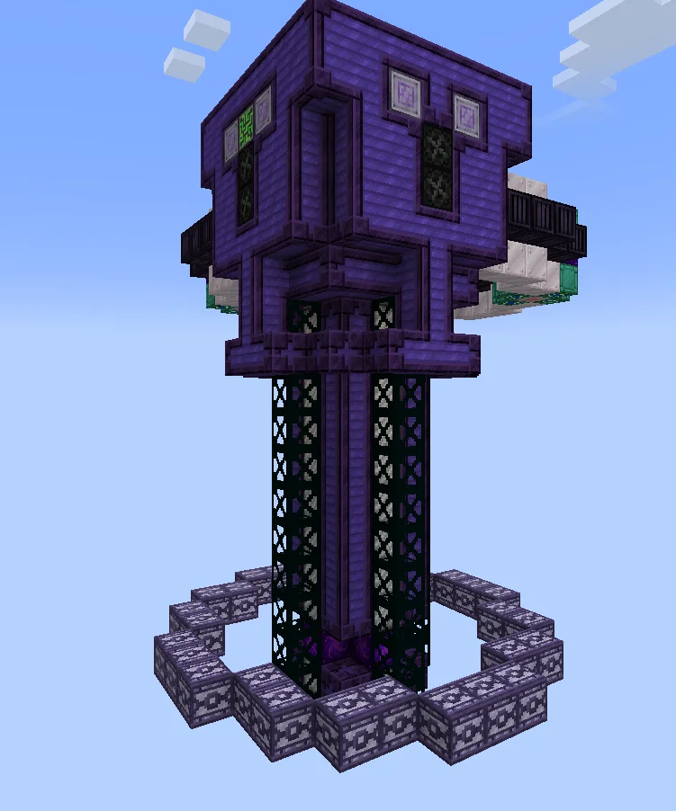
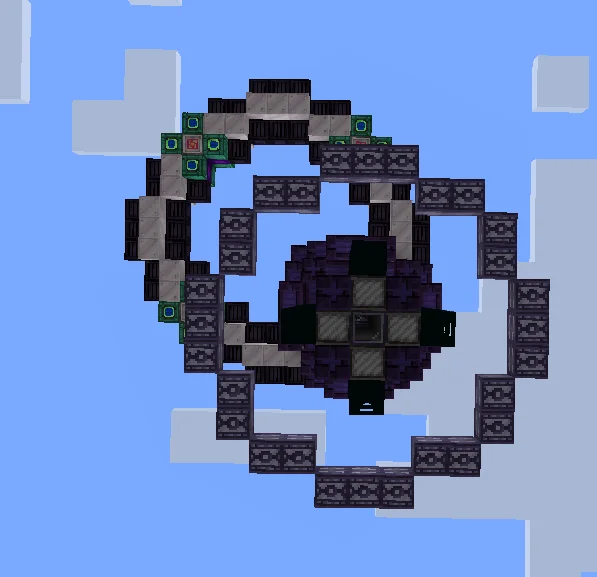
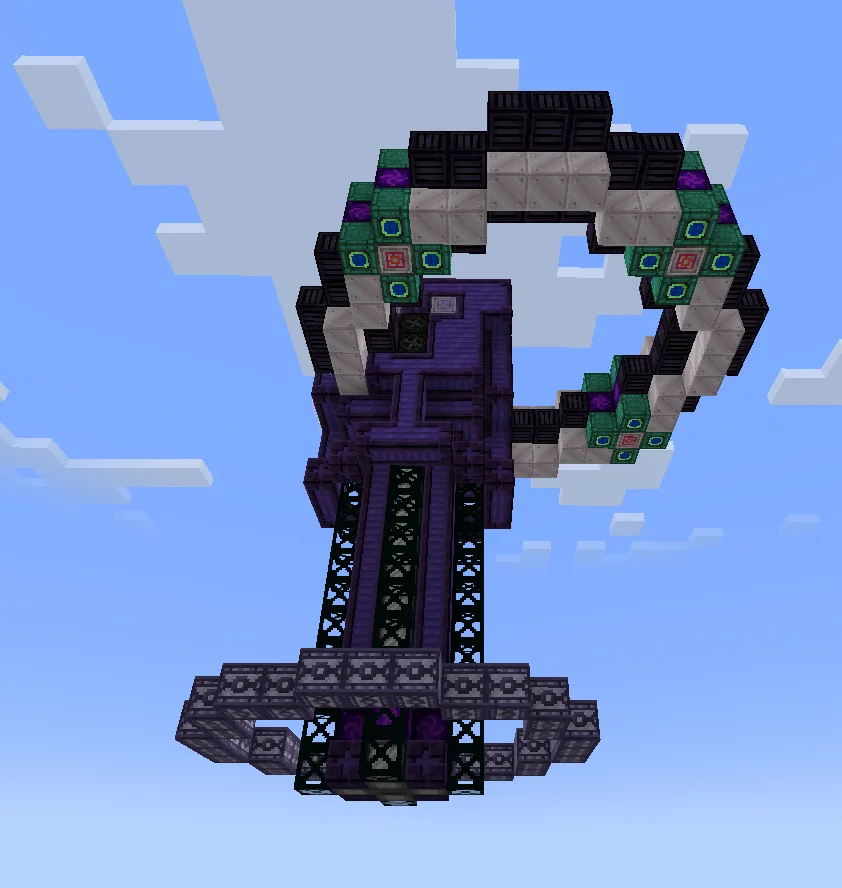
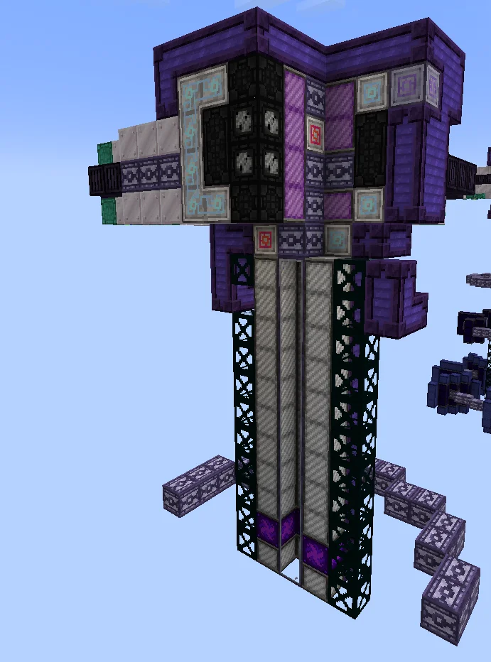
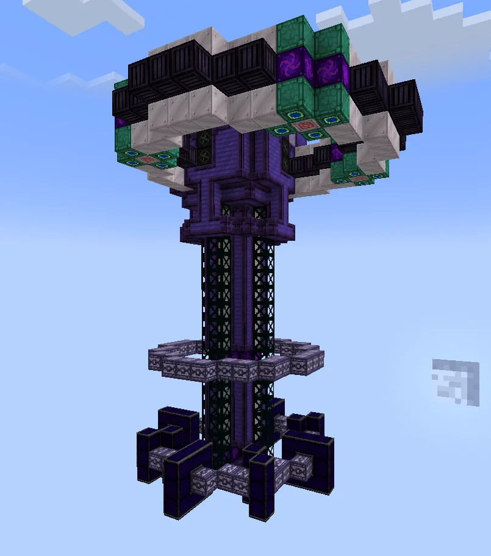
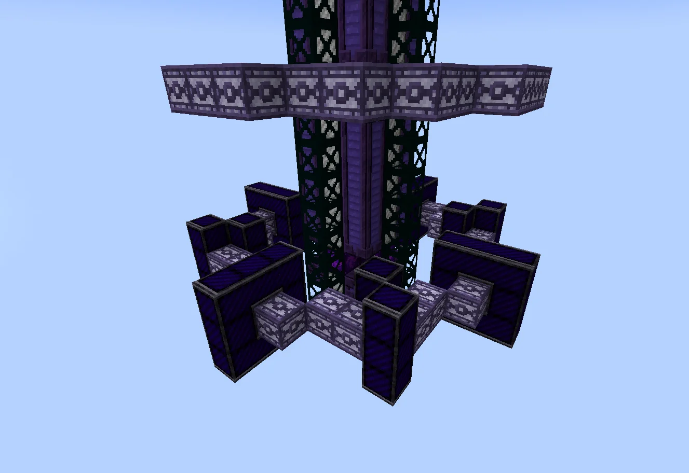
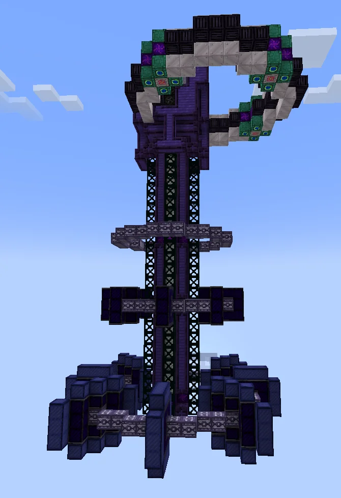
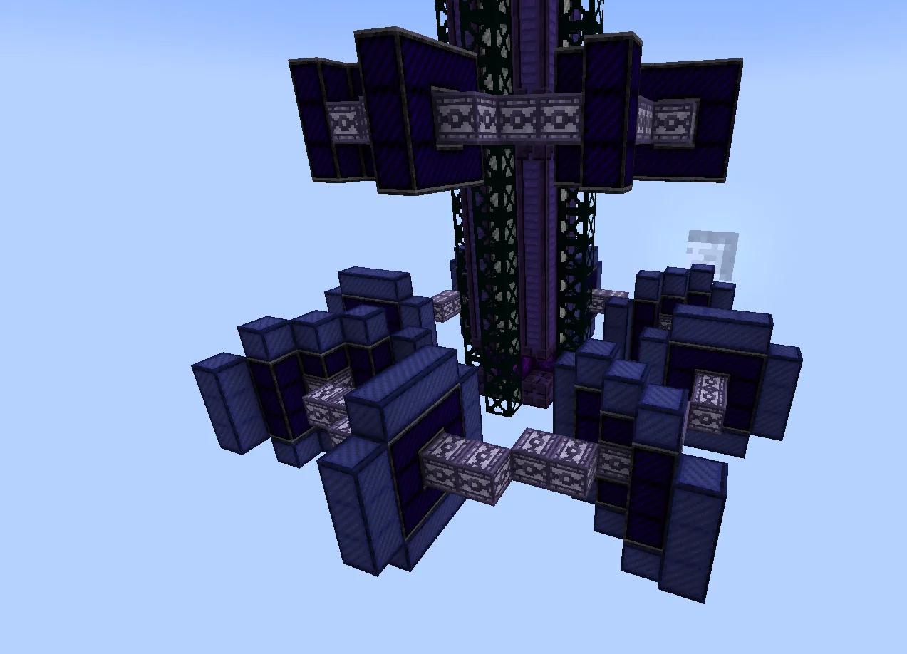

# Void Breaking Accelerator (VBA)
<small>**Submitted by:** Serinat (@serinat) · Multiblock Design Contest, September 2026</small>

!!! quote ""

| | |
|---|---|
| **Target tier** | <UHV>UHV</UHV>+ (soon after reaching the End) |
| **Role** | Resource generation — upgradable Void resource/energy generator |
| **Schematic** | [vba-i.nbt](Contest_img/void-breaking-accelerator/vba-i.nbt), [vba-ii.nbt](Contest_img/void-breaking-accelerator/vba-ii.nbt), [vba-iii.nbt](Contest_img/void-breaking-accelerator/vba-iii.nbt) |
| **Original post** | [Void Breaking Accelerator](https://discord.com/channels/1177211394039484477/1554828962067255347) |

## Summary

An upgradable multiblock that generates resources or energy from the Void. Its main gimmick is that it is upgraded by expanding the structure itself: each upgrade is a new section built onto the base machine. The multiblock is meant to be locked into pointing downward.

## Mechanics

- Upgrades are structural: the base version (VBA I) is extended with new sections to reach VBA II and VBA III. The author's in-game explanation is that the top ring is an "initiator", an accelerator that pushes particles with initial energy into the main chamber (the vertical tube), and each new section lets more energetic particles be launched into the Void to "break" it.
- VBA II adds a section built with Abyssal Alloy coils. The author proposes that this new section could also work as a better reflector in fusion rings (better efficiency on low-tier recipes plus new recipes).
- VBA III adds a longer section built with AUX II coils.
- Supports absolute parallel as well as the usual parallel controllers.
- Power is supposed to be delivered the same way fusion rings are powered. The <UEV>UEV</UEV> energy hatches in the build are placeholders; the first recipes are meant to use <UHV>UHV</UHV> hatches.
- The ME Controller block marks the intended position of the multiblock controller. Draconicware casings are placeholders for I/O, maintenance, and the absolute parallel block.
- A longer explanation of the mechanics is in a [separate Discord thread](https://discord.com/channels/1177211394039484477/1550230511639593081), which the author notes is "not really that in-depth".

## Structure

A tall vertical tube (the main chamber) topped by a ring (the initiator), with ring-shaped sections added around the lower part of the tube for each upgrade. The base version fits in 17x17x17; the upgraded versions exceed that limit, which the author says is acceptable.

!!! abstract "Screenshots"

    === "VBA I"
        

    === "VBA I top view"
        

    === "Initiator ring"
        

    === "Cross-sections"
        

    === "VBA II"
        

    === "VBA II section"
        

    === "VBA III"
        

    === "VBA III section"
        

## Files

- [vba-i.nbt](Contest_img/void-breaking-accelerator/vba-i.nbt) — structure block schematic of VBA I (base version)
- [vba-ii.nbt](Contest_img/void-breaking-accelerator/vba-ii.nbt) — structure block schematic of VBA II (first upgrade)
- [vba-iii.nbt](Contest_img/void-breaking-accelerator/vba-iii.nbt) — structure block schematic of VBA III (second upgrade)
