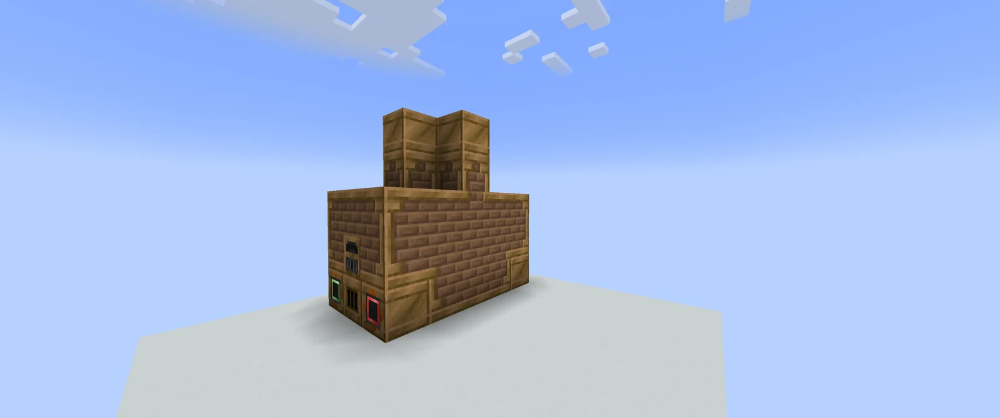
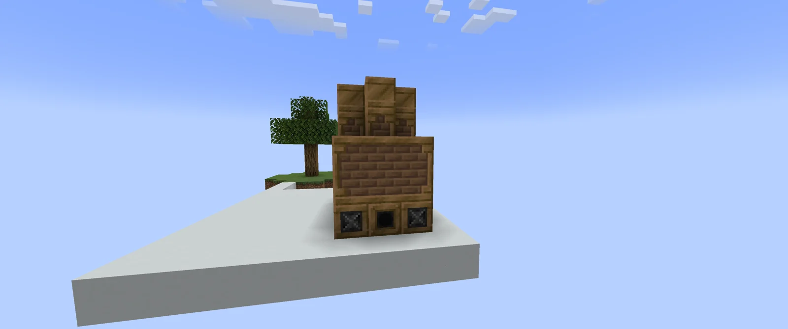

# Water Cooled Steam Solidifier (W.C.S.S)
<small>**Submitted by:** Bkyt (@bkyt__69351) · Multiblock Design Contest, September 2026</small>

!!! quote ""

| | |
|---|---|
| **Target tier** | <ULV>ULV</ULV> - <LV>LV</LV> |
| **Role** | Steam-age processing — steam-powered Fluid Solidifier for early parts |
| **Schematic** | [wcss.nbt](Contest_img/water-cooled-steam-solidifier/wcss.nbt) |
| **Original post** | [Water colled steam solidifier(W.C.S.S)](https://discord.com/channels/1177211394039484477/1552685817175089172) |

## Summary

A steam multiblock that works as a Fluid Solidifier, limited to materials up to Steel in progression. Its purpose is to make <ULV>ULV</ULV> - <LV>LV</LV> tier parts more cheaply before electric machines are available.

## Mechanics

- Steam powers the machine and is used to melt the metal; water is needed to cool the molten metal back down. This is why the structure has a second steam input hatch, which is meant for water.
- The author describes two operating modes, clarified in the thread:
    - **Ingot input:** needs both steam and water to work. The water is turned into steam, but at a loss.
    - **Liquid metal input:** takes water, the molten metal, and a cast, and outputs the solidified part plus steam.
- The machine would keep an internal buffer for both water and steam.

## Structure

A compact steam-casing block with a narrow two-block stack on top; the controller sits in the center of the bottom front row with a hatch on each side. The author did not state the dimensions.

!!! abstract "Screenshots"

    === "Front angle"
        

    === "Front"
        

    === "Back"
        

## Files

- [wcss.nbt](Contest_img/water-cooled-steam-solidifier/wcss.nbt) — NBT structure file

## Notes from the thread

- A reader proposed the recipe shape "water + liquid metal + cast in, steam + cast item out"; the author adopted it as the liquid-metal mode and confirmed the machine would have two modes, steam-consuming (ingot input) and steam-producing (liquid metal input).
- Asked how the buses appear "formed" in the screenshots, the author said the steam (bronze) hatches simply look that way in game.
