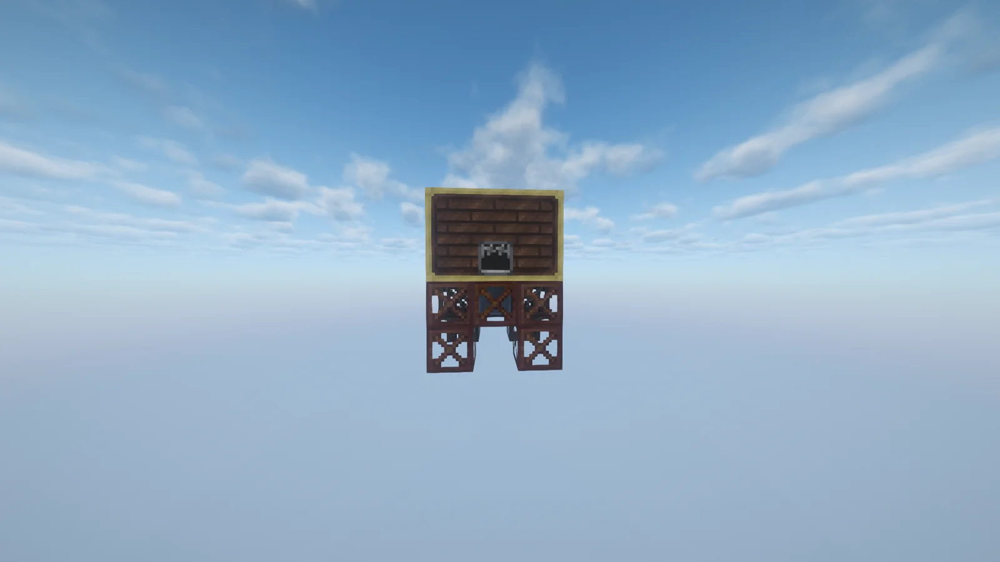
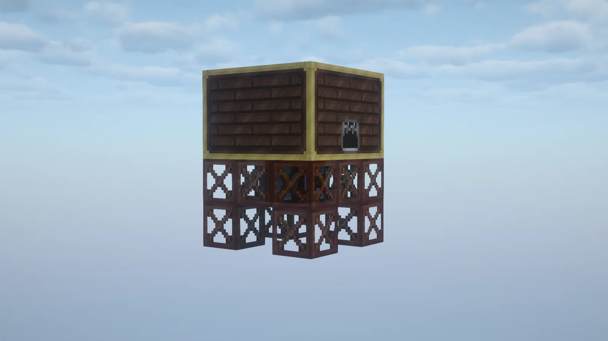
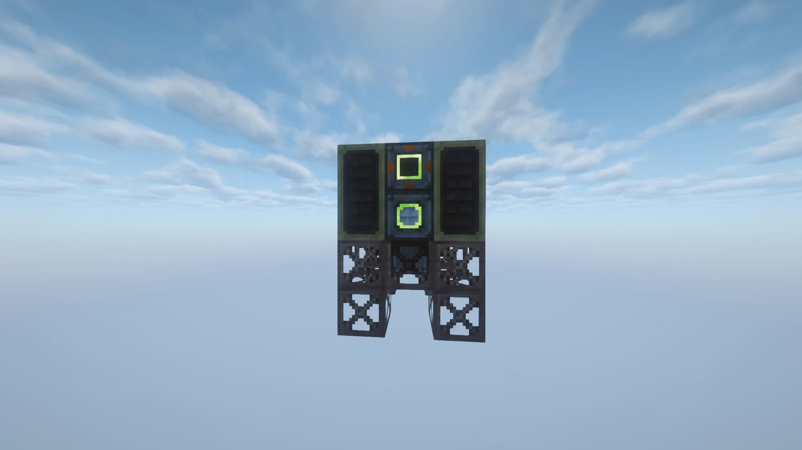
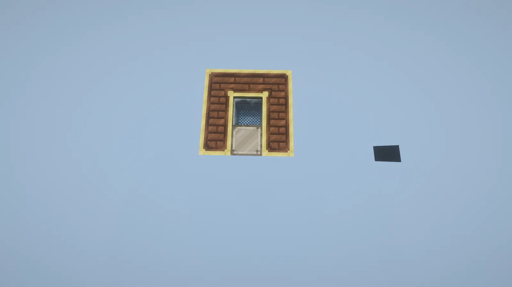

# Waterlogged Mechanical Sieve (WMSv)
<small>**Submitted by:** Corn Chex (@john_nutt) · Multiblock Design Contest, September 2026</small>

!!! quote ""

| | |
|---|---|
| **Target tier** | <LV>LV</LV> |
| **Role** | Processing — automated waterlogged sieve |
| **Schematic** | [waterlogged_mechanical_sieve.nbt](Contest_img/waterlogged-mechanical-sieve/waterlogged_mechanical_sieve.nbt) |
| **Original post** | [Waterlogged Mechanical Sieve (WMSv)](https://discord.com/channels/1177211394039484477/1553616455176560782) |

## Summary

A small <LV>LV</LV> multiblock that automates the waterlogged sieve. The author notes there is currently no way to automate waterlogged sieving, and while its outputs are only used for decorative blocks, producing them by hand becomes tedious when large amounts are needed.

## Mechanics

- Automates the recipes of the waterlogged sieve.
- Deliberately smaller than the regular Mechanical Sieve, since most players do not need much throughput from it.
- Items are input at the top and output at the bottom of the structure.

## Structure

A compact brick box with a gold-trimmed rim, raised on four open frame legs; the controller sits in the center of the front wall, and the hatches are mounted on the back. The sieve opening is visible from above. The author did not state the dimensions.

!!! abstract "Screenshots"

    === "Front"
        

    === "Angled"
        

    === "Back (hatches)"
        

    === "Top view"
        

    === "Bottom view"
        

## Files

- [waterlogged_mechanical_sieve.nbt](Contest_img/waterlogged-mechanical-sieve/waterlogged_mechanical_sieve.nbt) — Schematic Cannon (Create) structure file
