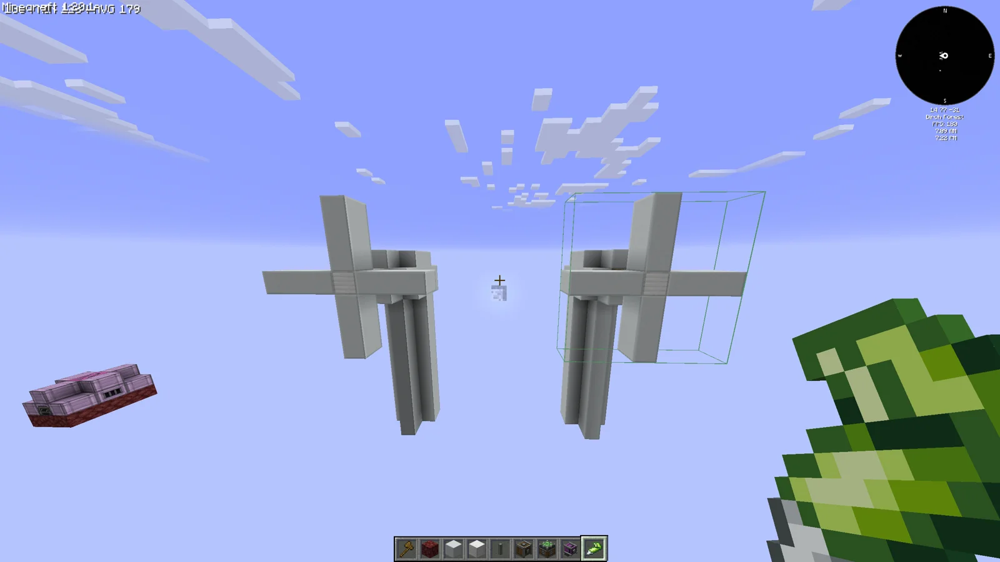
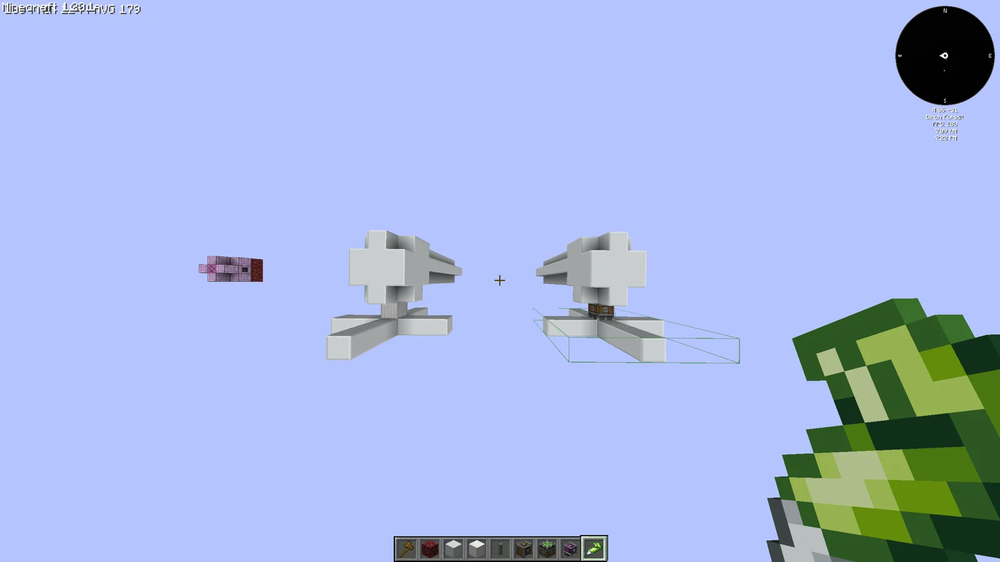
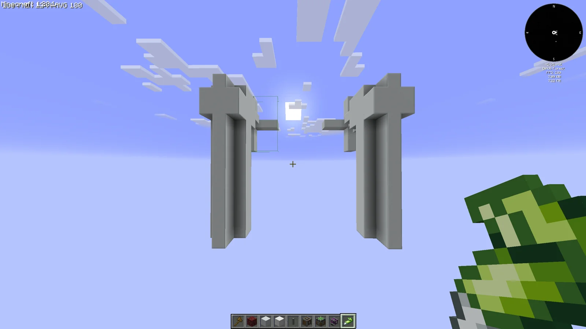
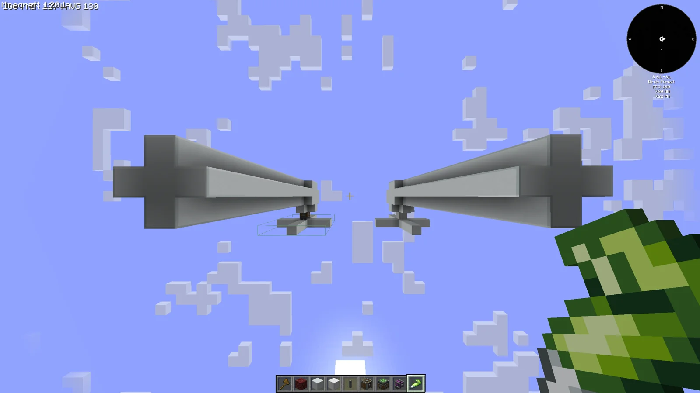
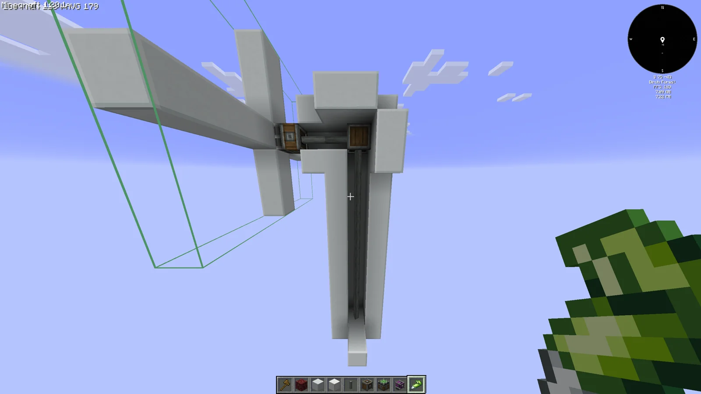

# Wind Turbines/Mills
<small>**Submitted by:** enlolers (@enlolers) · Multiblock Design Contest, September 2026</small>

!!! quote ""

| | |
|---|---|
| **Target tier** | <HV>HV</HV> |
| **Role** | Power generation — wind-driven turbine producing power |
| **Schematic** | [wind-turbines.json](Contest_img/wind-turbines-mills/wind-turbines.json) |
| **Original post** | [Wind Turbines/Mills](https://discord.com/channels/1177211394039484477/1552740264832016444) |

## Summary

A tall wind turbine (or windmill) multiblock that generates power simply by being exposed to air, or possibly to something that produces wind, such as an Encased Fan. The author built two versions: one is a static structure, the other actually rotates.

## Mechanics

- Generates power from wind, or, as the author puts it, "just nothing" (plain exposure to air).
- The author suggests that a wind source such as an Encased Fan could also drive it.
- The submitted build has no energy output hatch yet; the author notes one should go somewhere on the back of the structure, on the floor layer.
- Two variants were made: a purely decorative/static version and a moving version whose rotor turns.

## Structure

A tall two-legged tower of light-colored blocks with a four-bladed cross rotor mounted on a hub at the top; the moving variant turns the rotor on a Create Mechanical Bearing driven through shafts and a gearbox. The author did not state the dimensions; the attached template covers both versions in a region of 8 x 16 x 23 blocks.

!!! abstract "Screenshots"

    === "Front"
        

    === "Top view"
        

    === "Back"
        

    === "Side"
        

    === "Rotor hub"
        

## Files

- [wind-turbines.json](Contest_img/wind-turbines-mills/wind-turbines.json) — JSON block template ("Wind Turbine thingys") containing both versions: Plascrete, Iron Blocks, and Create shafts, a gearbox, and a Mechanical Bearing.

## Notes from the thread

- One commenter considered the entry redundant because the pack already has the Generator Coil, which they described as just another way to turn SU into energy; the author did not respond.
