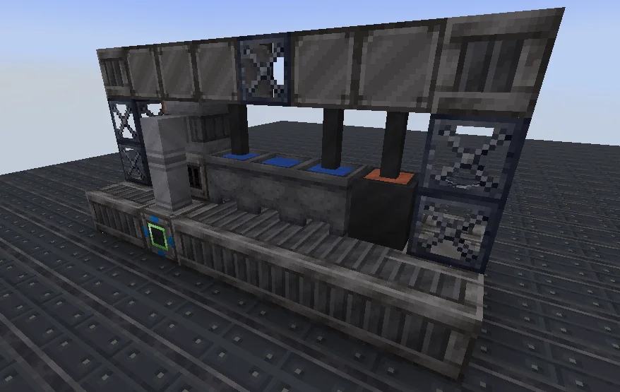
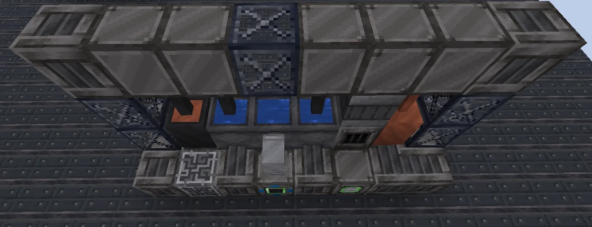
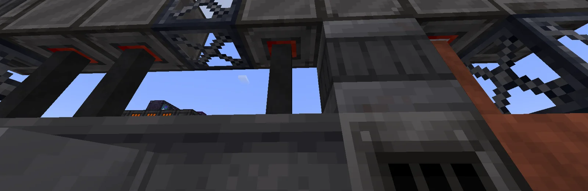

# Wire Insulation Plant (WIP)
<small>**Submitted by:** Kurtchekov (@kurtchekov) · Multiblock Design Contest, September 2026</small>

!!! quote ""

| | |
|---|---|
| **Target tier** | <LV>LV</LV> (the author notes it can easily be moved to <MV>MV</MV> or <HV>HV</HV> if that is too early) |
| **Role** | Processing — high-throughput cable insulation |
| **Schematic** | [wip.json](Contest_img/wire-insulation-plant/wip.json) |
| **Original post** | [Wire Insulation Plant (WIP)](https://discord.com/channels/1177211394039484477/1553802702805540874) |

## Summary

A dedicated multiblock for cable recipes. It offers higher throughput than Assemblers but handles only cabling (wire insulation) recipes, and it needs Water as an additional input for cooling. The design is modeled on how insulated cable is produced in real life (insulation extruded onto the conductor, then cooled), with changes made to fit the limitations of the game and the mod.

## Mechanics

- Runs only the cabling recipes, at a higher throughput than an Assembler. The author gives no specific parallel count or speed figure.
- Consumes Water as an extra input, representing the cooling stage of the real process.
- Inspired by a real single-core insulated cable production line; the author linked [this video](https://www.youtube.com/watch?v=DrIzdV5sKas) as the reference.
- The ME Controller in the build is a placeholder for the actual controller block.

## Structure

A long, low LV-tier machine: a base of Solid Machine Casings carrying a row of Cauldrons and a Steel Firebox Casing under a Steel Frame gantry, with cables and wires strung along the frame, a Steel Drum at one end, and the hatches, buses and placeholder controller in the bottom row. The author did not state dimensions; the schematic's bounding box is 8 × 4 × 3 blocks.

!!! abstract "Screenshots"

    === "Front"
        

    === "Back"
        

    === "Gantry detail"
        

## Files

- [wip.json](Contest_img/wire-insulation-plant/wip.json) — JSON template of the build (Building Gadgets format: block state list plus required-item counts, 50 blocks in total).

## Notes from the thread

- Several readers suggested extending the entry into a family: an <IV>IV</IV> parallel version and a late-game version, or making the multiblock mandatory above a certain tier once Assembler cabling recipes stop existing.
- Suggested coolant mechanics: different Water types reducing recipe duration (e.g. Distilled Water −10%), or coolant fluids granting conditional parallels (4 for Water, 16 for Distilled, 64 for Purified, 256 for Acidic, 1024 for De-ionized).
- A reader noted that GregTech multiblocks cannot specify the exact orientation/connections of wires or fluid pipes in the structure; another replied that this is something that can be added. The author did not respond to the feedback in the thread.
